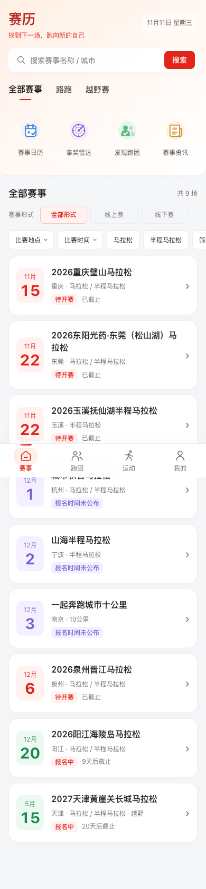
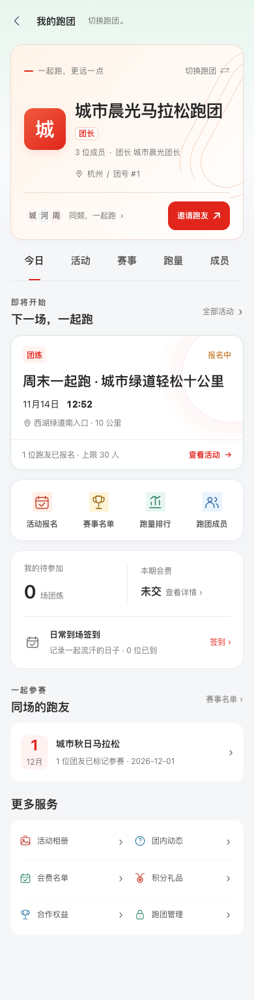
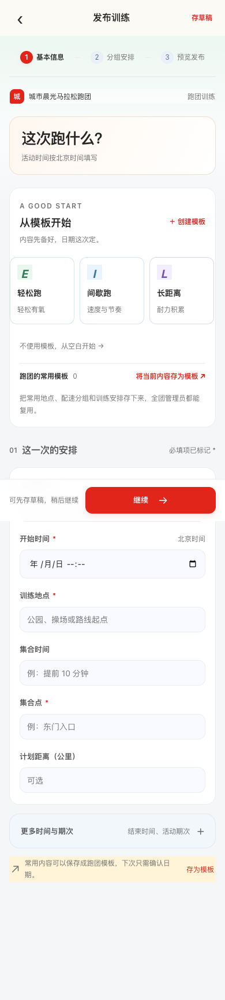
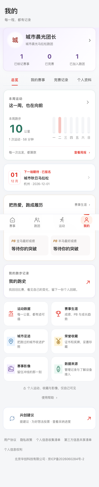
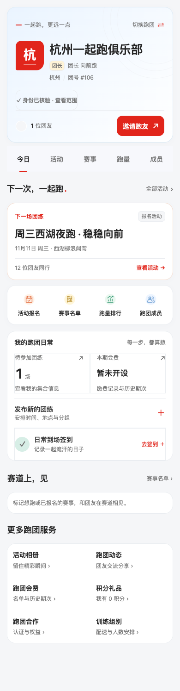
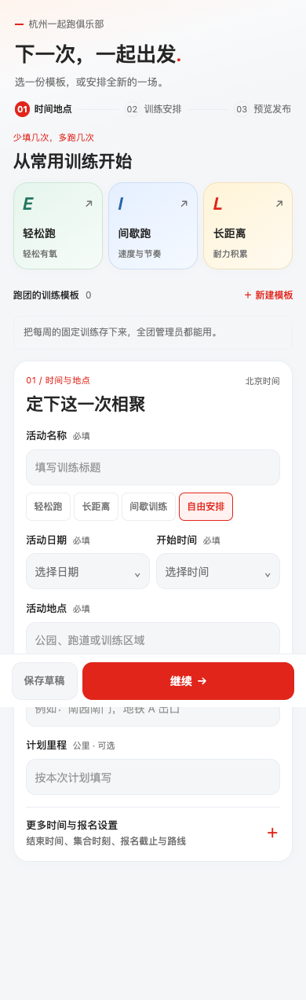
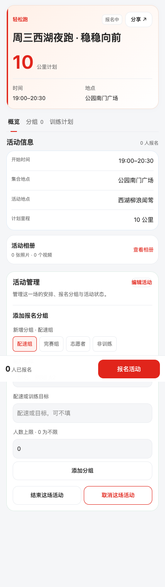
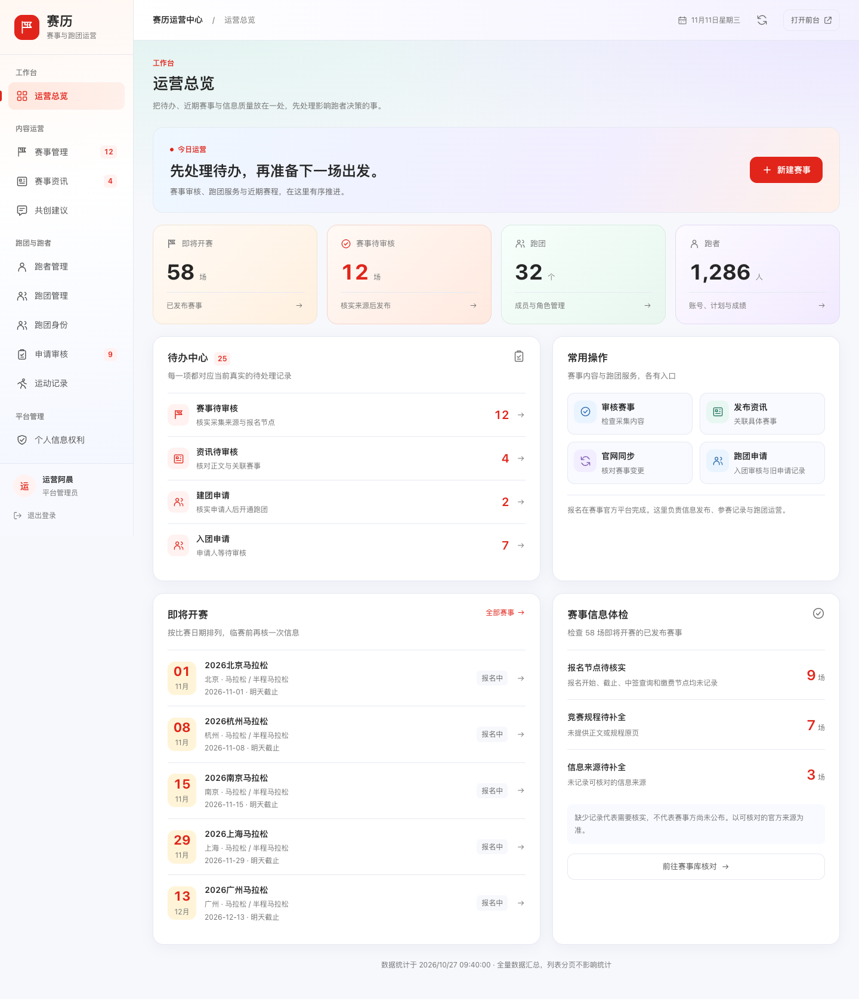

# 清爽多彩界面与训练模板

本目录保留本轮 8 张代表截图供 PR 和后续设计评审使用。完整 377 张页面截图和前后对比由本地审计脚本生成，不纳入源码提交。

浅灰页面、白色卡片与浅色顶部背景，保留红色主操作；薄荷绿、天蓝、柔紫和杏金集中用于图标、标签及少量重点信息。小程序图片为源码浏览器镜像，不能替代真机效果。

| Web 首页 | Web 跑团 |
| --- | --- |
|  |  |

| Web 训练发布 | Web 我的 |
| --- | --- |
|  |  |

| 小程序跑团镜像 | 小程序训练发布镜像 |
| --- | --- |
|  |  |





验证范围及 WXSS 漏报修正见[验收说明](../../../docs/ui-colorful-audit-20261111.md)。本轮完整页面检查共 514 项；后续真机反馈中的 15 处缺分号已修复，31 个 WXSS 严格解析和修正后的原生多入口编译均通过。

本地重建完整预览：

```sh
UI_PALETTE_PROFILE=colorful UI_AUDIT_OUT=design/previews/colorful-ui-20261111 UI_EXPECTED_ACCENT='#e1251b' node scripts/ui-system-audit.cjs web mini admin
```

需先安装项目依赖和 Chrome；微信原生离线编译另运行 `npm run test:mini`，需本机微信开发工具。
