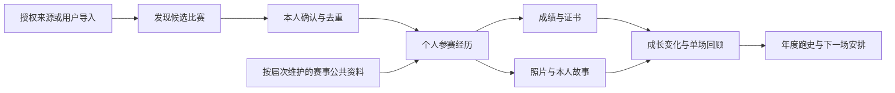

# MAKAKA 调研与跑者成长档案方案

调研日期：2026 年 11 月 1 日，北京时间。方案主线已由用户选择：**看懂自己的成长，并生成有个人味道的比赛回顾**。

本次结合用户提供的 MAKAKA 截图、公开官网与查询页面、摄影平台说明，以及本仓库现有功能进行调研。没有使用真实姓名、证件号、人脸或他人账号查询，没有购买会员，也没有验证 MAKAKA 后台。下文把直接观察、平台声明和产品推断分开说明。这里提出的新能力均是方案，不能当作项目已经开通的功能。

## 1. 产品判断

建议把这项能力定位为：**把跑过的比赛找回来，看见自己的变化，留下属于自己的回顾。**

自动收集是获得用户的关键入口；形成有用、有个人味道的回顾，才是后续反复打开和付费的理由。两者都要做，不能只做一个需要用户逐项填满的资料柜，也不能让第一期完全依赖尚未取得的全量外部数据。

第一期交付应当很具体：一个跑者带来几张旧成绩截图，几分钟内得到按时间整理的跑史、个人突破历程，以及一份有代表照片和本人感受的单场回顾。后续拿到授权数据后，同样的结果可以由自动同步触发。

这里的首期恢复，是整理用户提供或从官方取得的资料；姓名与身份证一键同步尚未确认接入，需并行验证来源授权与覆盖。

MAKAKA 截图已经有故事、同场跑友、完赛海报、模块配置和手表轨迹关联。这些功能名称本身不能成为我们的差异。我们应把重点放在**自动找出值得讲的变化、解释依据、保留本人表达，并连接下一次参赛**。

## 2. MAKAKA 能确认什么

### 截图直接支持的事实

| 观察 | 能得出的结论 | 不能据此推断 |
| --- | --- | --- |
| 28 场记录、19 场全马、9 场半马；页面同时有已入库和未入库 | 比赛发现与长期归档存在两个阶段 | 这就是该跑者全部历史比赛，或每条均经官方核验 |
| 有带不同平台水印的照片 | 展示内容涉及多个摄影来源 | MAKAKA 已取得这些平台的接口、原图或再加工授权 |
| 奖牌、路线图、参赛服、号码布、证书、故事等模块可维护 | 公共赛事资料和私人资料被组合展示 | 所有模块都由后台自动抓取，或都由人工录入 |
| 完赛证书出现等待官方数据，也能自己上传 | 至少存在暂缺与人工补充状态 | 证书一定能补齐，或者来源有统一可用期限 |
| 有非本人照片处理入口 | 产品为照片归属纠错提供了入口 | 能估算实际照片识别准确率 |
| 同一赛事在不同截图中出现成绩缺失与有成绩 | 资料可能分阶段补充 | 能确认具体同步机制，或据此判断系统故障 |

截图中的收费为：半年 128 元、年度 198 元、三年 398 元；半年赠 10 次、年度赠 20 次、三年栏显示赠 60 次历史赛事入库；年度单场空间为 500M。另有会员期内及购买前 7 天的赛事自动入库说明。截图不能完整说明到期后保留、导出、退款以及其他套餐规则，不能补猜。

这套收费把历史整理、新赛自动归档和存储打包出售。它证明竞争对手在尝试商业化，不能证明用户转化率、续费率或盈利情况。

### 官网公开声明

[MAKAKA 隐私政策](https://makaka.run/privacy.html)标注更新日期为 2026-06-01。第 1.2 节说明，查询功能可能授权查询第三方平台，并涉及加密姓名、身份证号；第 1.4 节涉及比赛成绩和图片管理；第 1.5 节声明设备与运动应用数据关联、运动分析和分享内容生成。

这些声明支持“第三方数据查询”这一方向，但**没有公开具体成绩提供方、摄影平台、授权范围、覆盖率和更新机制**。政策里提及某品牌，也不能证明对应连接已全部上线。[用户协议](https://makaka.run/user.html)标注运营方为成都乐燃科技有限公司。

另找到一篇[小河淌水半马与 MAKAKA 的合作宣传转载](https://www.sohu.com/a/1081182406_121124658)，提到官方数据服务合作及赛后归档。但发布者为第三方搜狐号，本次没有取得主办方原始公告或合同，因此仅作为合作模式线索。

### 对实现方式的合理推断

最符合可见功能的架构，是先发现个人参赛记录，再针对每场比赛查找证书、照片与公共物料，后台持续补充，用户可以更正。下图是**我们建议采用的架构，也是对其可能架构的推断，不是已验证的竞品后台**。

## 3. 姓名和身份证能不能找齐全部历史比赛

**能成为重要的历史成绩发现方式，但现有证据不支持“找齐全部历史比赛和全部素材”的承诺。** 成绩库覆盖、赛事上传审核、查询条件、赛事停办、官网迁移、个人资料不一致，都可能造成缺失；越野、海外赛、线上赛也不能默认纳入国内路跑成绩库。

| 来源 | 本次核实到的查询形态 | 对产品的影响 |
| --- | --- | --- |
| 中国马拉松 | [荆州市文旅官方政务号指南](https://m.thepaper.cn/newsDetail_forward_32480676)说明姓名与证件号码查询 A、B 及部分 C 类成绩，也说明上传审核与 C 类历史覆盖缺口。官网当前直访遇到反自动化挑战 | 全国来源适合作为发现入口；本轮未直接验证当前个人查询全流程，也未找到可据以承诺接入的开放授权文件 |
| 北京马拉松 | [官网](https://www.beijing-marathon.com/)的成绩入口指向[查询页](https://beijing-registration.mararun.com/score.html)；公开前端要求选择赛事、证件号、验证码，结果结构含证书及净时、枪声分段 | 是单来源适配；需要官方许可的自动接口或用户按官方流程操作；发现成绩与取到证书仍要分别记录 |
| 厦门马拉松 | [成绩页](https://www.xmim.org/grade)公开前端包含姓名、证件号、验证码，结果结构包含年份、项目、号码、枪声与净成绩及排名、证书、分段 | 某些赛事来源数据更丰富，适合优先验证分段复盘，但不代表所有赛事都有这些字段 |
| 上海马拉松 | [官网](https://www.shang-ma.com/)公开导航将我的成绩、我的证书标成需要登录 | 不能靠一套姓名证件号查询覆盖，需要官网账户流程或合作授权 |
| 跑步维生素 | [官方找照片页面](https://www.runff.com/html/photo/find.html)有参赛号码、年份、赛事条件 | 照片要在匹配赛事与号码后单独查找；本次未验证第三方接口授权和原图费用 |
| 爱云动 | [官方说明](https://www.runnerbar.com/faq/)及[选手问答](https://www.runnerbar.com/#/runner/qa)说明按赛事、头像、号码布找照片，带水印标清与原图有不同规则 | 姓名证件号不是通用照片检索键；站内同步与二次加工需要另外核实权利和合作条件 |

全国库覆盖说明来自政务号转载，并非本轮亲自读到的田协原始公告；其中提到 2025-03-22 前 C 类赛事的历史缺口，只适合用于解释为什么会缺记录，不应变成我们自行认定某条成绩无效的规则。

北京、厦门、上马的字段判断依据是当前公开前端，没有提交个人查询，因此只证明界面与结果模型，不证明具体跑者一定有结果、证书文件一定有效。公开页面里能看到请求，也不等于对方允许第三方持续调用。

爱云动的[详细问答](https://www.runnerbar.com/#/runner/qa)还涉及历史原图离线激活、调档与保存差异。这意味着媒体成本除了存储，还可能包括取回、授权和用户购买费用。不能承诺开通本平台会员就包含所有第三方原图。朝阳风采目前仅有截图水印，本次未确认其主体和接入方式。

## 4. 数据接入怎么做更好

建议同时推进两条线：**近期把整理与回顾体验做完整，接入验证从一开始就并行做。** 自动发现跑史具有明显用户价值，不应轻易放弃；但产品也要在外部来源缺失时可用。

### 近期能交付的完整链路

1. 用户批量选择成绩截图、证书或成绩表；也可从官方来源取得文件后导入。
2. 系统识别赛事届次、日期、项目、号码布、净计时、枪声时间，形成候选。
3. 核对页优先展开名称不确定、年份不一致、净枪混淆和重复记录；确定的记录可批量确认。
4. 确认后形成个人跑史和回顾；已保存照片与素材可以逐步补充。
5. 支持的来源通过明确的授权接口自动补充；需要官网操作的来源给出对应入口，回来后接续导入。

必须允许“赛事库里暂时没有这场”，先保存在本人跑史，不要求用户等待运营建赛事后重来。旧文件、失效官网和非认证比赛也能留下自己的参赛经历。

### 自动接入验证的优先顺序

| 优先级 | 路径 | 通过什么才进入产品 |
| --- | --- | --- |
| 1 | 向全国成绩服务及其运营方了解授权查询、用户数据导出或合作机制，同时寻找可合作计时商 | 对方明确允许的接入方式、字段、身份授权、覆盖范围、费用与更新方式；本次未确认可以获批 |
| 2 | 选择用户实际跑过、且查询形态不同的 3–5 个赛事来源验证 | 以本人授权样本核对成绩、证书、分段和异常情况；登录验证码只走来源允许流程 |
| 3 | 先接本平台合作赛事或跑团合法取得的赛后成绩 | 来源有依据；代填与本人确认分开；不能仅凭团长上传就认定官方核验 |
| 4 | 摄影平台商务与技术合作 | 先核对可提供的检索方式、预览/原图、个人保存/加工/分享范围、删除机制，再决定站内体验 |

对每个来源维护一个简单的能力表：支持哪些年份与项目、所需字段、登录/验证方式、是否有分段和原版证书、许可范围、最近一次有效检查、费用及故障情况。页面据此告诉用户“已找到成绩”“需要在官网完成操作”“可以上传补充”，不让用户猜。

### 三类资料采用不同策略

- **个人成绩、证书、号码布**：按本人参赛经历保存。成绩是结构化事实，证书是独立原件；没有证书不阻止先保存成绩。
- **本人照片、视频、故事、手表活动**：分别标来源和归属。号码布或人脸匹配先生成候选，允许标“不是我”；用户已下载原图也要区分个人留存和平台生成公开作品的使用范围。
- **赛事路线图、通用奖牌图、参赛服图**：按赛事届次维护一次，记录来源和版本，复用到个人回顾。通用奖牌图只代表赛事物料，不能自动证明此人领过奖牌或穿过该衣服；个人实拍可以另存。

照片先提供官方查找入口与本人文件导入；取得合作后再逐步改为站内发现。无需先自建全网人脸库才能证明产品价值。

### 身份信息的具体设计

日常成长档案不需要身份证作为个人资料必填项。确有授权查询来源需要时，在该操作内说明用途、接收方与必要字段，并单独处理；姓名证件号也不能作为认领平台账户或接管历史资料的唯一凭证。

优先让用户在官方侧完成身份验证，平台只取得授权结果。确需本方临时接收证件号时，要设计独立的短时任务、脱敏日志、失败清理和受限访问；若有持续同步必要，按明确目的、期限和撤回方式单独设计，不以“以后也许用得上”为由长期保存。哈希和“加密”本身不等于匿名化。

涉及身份证、人脸、运动轨迹等新增处理，需随真实数据流更新现有政策与微信声明。[《网络数据安全管理条例》第 22–24 条](https://www.gov.cn/zhengce/content/202409/content_6977766.htm)对敏感信息同意、权利受理及删除等有明确要求。用户授权查询和来源方允许第三方使用，是两件都需要核实的事。

## 5. 主体验：让跑史成为自己的故事

用户实际想完成的三个任务是：我以前跑了什么；这些年我有什么变化；这一次有什么值得留下。

“成长”不能仅等于越跑越快。首马、第一次陪朋友跑、久别后重返、在陌生城市完成比赛，甚至认真决定退赛，都可能是重要经历。成绩进步由数据算，个人意义由本人选择或表达。

### 跑史页先出现什么

页面标题建议“我的跑史”。延续项目红、白、浅灰风格，以时间、成绩和照片建立层次。页面结构可用：

1. 一条最值得看的变化，例如“从首次全马到现在，你在已记录比赛中进步了多少”；资料不足则先给导入入口。
2. “看成长 / 留回忆”两个阅读方式，使用同一批记录。
3. 成长视图按年月展示比赛和突破节点；回忆视图展示本人选出的比赛与一句话。
4. 单场打开是可阅读的回顾，证书和其他资料放在展开区域。

不把奖牌、证书、服装、路线逐一铺成大空模块。不使用“资料 57% 完整”迫使每个人追求同一种收藏方式；只提示影响当前任务的缺口，例如“补充净计时后可比较个人纪录”“补充分段后可看前后程变化”。

### 单场回顾的默认成品

**第一段：发生了什么。** 日期、赛事、项目、净/枪口径明确的成绩，来自哪条记录，用户能更正。

**第二段：这场与你的过去有什么关系。** 只挑最有意义的一到两项：首场、此前最佳差值、同赛事历年对照、与本人设定目标的差。每项注明比较范围。

**第三段：你想留下什么。** 系统建议 1–3 张照片，用户选一张，回答一个轻问题：“这场最想记住的是什么？”可选突破、陪伴、归来、城市、坚持，也可自己写。资料与文字形成一份完整作品，不要求先写长赛记。

**第四段：下一次可以带走什么。** 有分段时展示明确的配速事实；没有分段就保留本人总结或下一场目标，不猜撞墙、补给失误、伤病和训练原因。

例如演示数据：此前最快全马 03:52:42，这次 03:12:45，差值为 **39 分 57 秒**。可以生成“在已记录的同项目净计时成绩里，这是新的最好成绩”。只有这两个用时，不能写“后半程稳定”“经过科学训练提升”或“超过全国 90% 跑者”。截图不是用户完整跑史，不能直接据此宣布其真实 PB。

## 6. 后续加工的优先级和数据前提

| 加工成品 | 跑者获得什么 | 最少需要的数据 | 建议阶段 |
| --- | --- | --- | --- |
| 个人突破历程 | 看清第一次完成、每次突破以及间隔 | 日期、项目、完赛状态、计时口径、成绩与来源 | 第一期 |
| 有个人味道的单场回顾 | 事实、变化与本人感受形成可保存的一页 | 已确认成绩、可选照片、本人一句话 | 第一期 |
| 同一赛事多年对照 | 同城重跑时看到自己的变化 | 赛事系列/届次关联、同项目同口径成绩 | 第二期；赛道变化要提示 |
| 年度跑史 | 自选本年最有意义的几场，形成几个章节 | 跑史、标签、照片、本人文字 | 第二期；一张年报与多页纪念册可分层 |
| 跑团共同回忆 | 组织者少收一次表，团友各自保留经历 | 本人选择分享的成绩、素材及相应授权 | 复用现有战报逐步加，不默认公开个人材料 |
| 配速过程复盘 | 看前后程差、各段用时与变化位置 | 可靠官方分段及其口径 | 来源取得后；累计分段先转为区间，未知不补零 |
| 照片串起赛程 | 照片与路段、时刻对应 | 校准的拍摄时间/位置、赛道或轨迹、匹配质量 | 后期；摄影机时钟和开跑时刻偏差必须处理 |
| 跑史服务下一场 | 为重跑赛事和设定目标提供依据 | 可靠历史、本人目标、明确来源的赛道/赛期信息 | 渐进接回现有赛历；先提供对照，不给伪精确预测 |

内容生成采用“算出事实 → 选择有意义的变化 → 结合本人表达 → 排版成品”。成绩计算、PB 和分段使用确定规则；AI 可以辅助识别、主题建议、文字整理，不能自行补出未提供的体验。

生成稿需能逐句追到来源事实或本人文字，标成可编辑草稿。没有本人表达时用第三人称事实描述，不伪造第一人称感受；先预览，发布是另一步。用户改了成绩后，相关回顾需要提示更新，已发布作品不要静默换内容。

“为什么这次变快了”需要足够训练、环境和本人反馈，即使有相关性，也不能直接认定因果。第一期不生成综合实力分、全国百分位、伤病风险、比赛日状态分或自动训练处方。

## 7. 适合当前项目的实现边界

本项目已经有赛事生涯、年度趋势、PB、城市护照、私人收藏、成绩故事、跑团战报，以及 FIT/TCX 运动摘要导入。见 [README](../README.md)、[跑者个人中心设计](../design/跑者个人中心设计方案.md)、[runner-center.js](../server/src/runner-center.js)。

已有的[中国马拉松适配器](../server/src/official.js)获取赛事目录与详情，**不获取个人历史成绩**。运动文件当前不持久保存轨迹和心率，也没有厂商自动同步，不能直接用来做路线回放或心率分析。

需要补的基础模型比再加一个荣誉墙重要：

| 层次 | 应保存的内容 | 主要原因 |
| --- | --- | --- |
| 赛事系列与届次 | 标准名称、年份日期、项目、城市、来源别名、公共素材版本 | 同名异届、改名与迁移不能误合并 |
| 个人参赛经历 | 所属人、赛事/暂未匹配的比赛、项目、号码布、参赛角色、完赛/DNF/DNS等状态、本人感受 | 有经历未必有完赛成绩；先存照片和故事也应成立；DNS 不计为实际参赛 |
| 成绩与证据 | 净时、枪时、分段、名次及口径、来源、取得时间、本人确认、核验方式 | OCR 识别、本人确认、来自官网、官方核验是不同状态 |
| 素材与可用范围 | 本人/公共、源资源 ID、文件、清晰度、水印、归属、使用范围、删除状态 | 链接可访问不等于可以转存、加工和公开 |
| 导入候选与处理任务 | 原来源、解析结果、冲突、匹配、重试、用户改动保护、来源删除选择 | 自动化可恢复，也不覆盖本人修正或把已删除记录重新拉回来 |
| 生成作品 | 选用哪些版本的事实、本人文字、所选素材、模板版本与分享范围 | 支持纠错、重新生成、撤回和说明依据 |

这些是逻辑层次，不要求第一期全部建成独立服务。继续使用现有后端即可，先补参赛经历、来源证据和候选确认链路。原有成绩与收藏需保留并迁移关联，不能用自动同步覆盖旧数据。

当前成绩接口只有一个用时，收藏也需要先选成绩。需解除“没有正数完赛成绩就不能保存比赛资料”的限制。新增经历后，个人跑史仍不能把 DNS、未完赛和已完赛混成同一个完赛数。

去重按来源 ID 和“赛事届次＋项目＋本人”判断，先处理同场多项目、近似名称和冲突；用时相同或昵称相同都不足以证明同一记录。手表 42.6 公里不改写官方全马 42.195 公里，跑表活动与比赛成绩关联后也不重复累加训练公里。

默认回顾、证书和候选照片只给本人看。保留现有成绩在跑团内的可见规则，但不得据此把新导入的私人附件也同步给团长。本人分别选择分享哪些内容；官网证书内的证件号、联系方式以及不必要的原始姓名在公开作品中应隐藏。

## 8. 第一版到底做什么

首版围绕一个闭环，按依赖推进：

1. **来源与样本验证**：招募约 10–15 位自愿跑者，覆盖首马、有多年历史、多证件/旧资料、全半马及其他赛事。本人提供或在官方侧取得样本。整理约 100 条参赛经历作为小规模验证集；不是行业统计样本。
2. **恢复跑史**：允许历史临时赛事与无成绩经历；批量截图/证书/结构化表导入；显示来源；核对冲突；去重；保留用户更正。
3. **立即交付回顾**：导入完成即得到突破历程和单场草稿；本人只需选图、补一句话，即可预览保存。
4. **连接已有产品**：从生涯进入，沿用私人收藏；本人选定内容后进入现有团内战报；从回顾回到下一场安排。
5. **逐个替换人工环节**：授权来源准备好后接入同一候选与确认流程，并测试撤回、删除、更正和重新同步。

第一期不以自建摄影平台、全网人脸搜图、自动视频纪录片、完整路线重建为交付前提。这里的“立即交付回顾”也不等于证书、照片全部已找齐；每类资料有自己的状态，已取得的内容先有用。

本次附带[可点击的独立概念预览](../design/prototypes/race-life-concept.html)，演示跑史、单场回顾和导入核对。使用明确标识的演示数据，不连接真实身份、文件上传或业务接口。

### 首轮怎么判断值得继续做

以下是拟定的实验目标，不是已经达到的指标：

- 让测试用户用自己的 10 条记录，争取 5 分钟内完成核对并看到首份回顾；分别记录等待时间与操作时间。
- 用本人已确认的实际跑史作分母，按来源统计找到多少、缺多少、错配多少；不能用“返回 28 条”当作全量覆盖率。
- 第一轮发布前抽检应无已知的串人、净枪混用、错误项目 PB、被删除记录复活；未解决的冲突留在候选区。
- 导入用户是否看完回顾、愿意保存，以及能否说清“这份回顾告诉我一个原来没看出来的变化”。
- 记录本人改了多少事实与文字。事实大量被改，先修数据；文字总被清空，先改表达方式。
- 7/30 日回访之外，跟踪下一次完赛后是否回来生成回顾。跑史是事件驱动产品，不以每天打开作为唯一成功标准。
- 单条确认记录的处理成本、每份满意回顾的成本、客服整理时间、媒体存储和下载成本均单列。

## 9. 收费建议

不建议首期直接复制“每场比赛入库扣次数”。恢复完整跑史是后续价值形成的前提，过早按场收费会阻碍用户把资料带进来。

建议基本成绩保存、纠错和合理范围的数据副本/导出保持易用，常规容量内的自主整理与基础回顾用于建立信任。付费围绕用户明确感知到的交付：

| 付费项目 | 购买的结果 | 必须讲清的范围 |
| --- | --- | --- |
| 历史跑史整理服务 | 帮用户整理散落资料、处理匹配并请其确认 | 可处理资料、工作量、无法找回的项目、交付及售后；不承诺全网找齐 |
| 年度纪念册/主题作品 | 经本人选择的照片、事实与文字形成高质量成品 | 预览、修改、导出格式；印刷、第三方原图与版权范围另核对 |
| 持续归档与额外空间 | 支持来源的新赛自动发现、媒体空间和批量作品 | 支持清单、容量、到期后保留/只读/下载窗口和明确通知；不能空泛承诺永久 |
| 跑团赛季记录 | 经成员选择的集体战报和年度册，减少组织者重复收表 | 团长购买不等于可以读取成员全部私密资料 |

可在有真实成本和满意样本后，测试“单次整理/单份作品”与“年度持续服务”的支付意愿。具体金额应由处理成本与付费实验决定，不能从竞品 198 元反推我们的合理定价。

成本至少包括来源合作、查询任务、OCR、内容生成、存储备份、下载流量、人工纠错、退款与支付。可先用约 20 位付费试用跑者的小规模服务验证需求，但没有支付与履约能力前只做访谈和明确的购买意向测试。

## 10. 最值得积累的长期能力

持续积累应落在四处：赛事届次与来源匹配越来越准；用户自己的完整跑史与主动标注的意义；每种数据能可靠生成哪些结论；回顾表达与本人偏好越来越贴合。

公共奖牌图、服装图和普通海报模板容易被复用，单纯把它们收齐不构成强壁垒。更有价值的体验是：同一个人在不同年份打开，都能看见新变化；下一次跑完，愿意把这一场继续放进来。

## 11. 证据与核验记录

以下均于 2026-11-01 作公开只读核验。搜索工具当时不可用，采用搜索引擎网页与来源官网直接读取；搜索摘要只用于定位，事实优先以原页面为准。

| 来源 | 本轮实际读取及限制 |
| --- | --- |
| 用户截图 | 直接观察界面、价格与文案；未登录其账号验证订单、流程或长期效果 |
| [MAKAKA 隐私政策](https://makaka.run/privacy.html)、[用户协议](https://makaka.run/user.html) | 直接读取政策正文。站点 TLS 证书校验失败后，仅对无凭证公开文本作读取；没有输入身份或执行账号操作。政策是其声明，不是后台审计 |
| [中国马拉松](https://www.runchina.org.cn/) | 当前直访返回 JS 反自动化挑战，未继续处理；不宣称亲自验证了大众成绩检索流程 |
| [荆州市文旅政务号查询指南](https://m.thepaper.cn/newsDetail_forward_32480676) | 正文可读，2026-01-28；全国成绩范围的二手说明；不能将文中一般性证书期限扩展为所有赛事统一规则 |
| [北京马拉松](https://www.beijing-marathon.com/)、[查询页](https://beijing-registration.mararun.com/score.html)、[公开前端脚本](https://res.mararun.com/online/beijing-registration/assets/js/beijing-registration/score.446b.js) | 官网入口与前端字段/结构；未做真实个人查询。带版本号脚本可能随站点升级更换 |
| [厦马查询](https://www.xmim.org/grade)、[公开前端脚本](https://www.xmim.org/umi.02448022.js) | 读取字段、证书与分段相关结构；未做真实个人查询 |
| [上马官网](https://www.shang-ma.com/)、[证书入口](https://static.shang-ma.com/web/user/index.html#/certificate)、[公开导航脚本](https://static.shang-ma.com/web/assets/match-1ad528f8.js) | 当前导航要求登录；没有读取登录后的成绩资料 |
| [爱云动 FAQ](https://www.runnerbar.com/faq/)、[选手问答](https://www.runnerbar.com/#/runner/qa)、[合作说明](https://www.runnerbar.com/#/events/cooperation) | 公开官网与其内容资源；确认照片检索与预览/原图规则；未发现可据以宣称已取得合作的公开 API 授权 |
| [跑步维生素找照片](https://www.runff.com/html/photo/find.html)、[商业合作](https://www.runff.com/html/hezuo.html) | 可读查询条件与联系入口；商务页为早期内容，不当作当前价格或授权承诺 |
| [小河淌水 × MAKAKA 转载](https://www.sohu.com/a/1081182406_121124658) | 仅作为合作线索，尚未取得主办方一手确认 |
| [《网络数据安全管理条例》](https://www.gov.cn/zhengce/content/202409/content_6977766.htm) | 中国政府网现行公开原文，用于新增数据处理的设计依据；不据此作本平台已经合规的承诺 |

现有《产品方案》第 4 节中对所有查询链接、合作字段与当前验证码形态的绝对化描述，不应直接当作本轮核验结论。具体来源的链接是否含身份信息、是否有访问控制、允许怎样接入，应分别核实。本文作为新的研究与设计提案，不改写既有业务行为。
