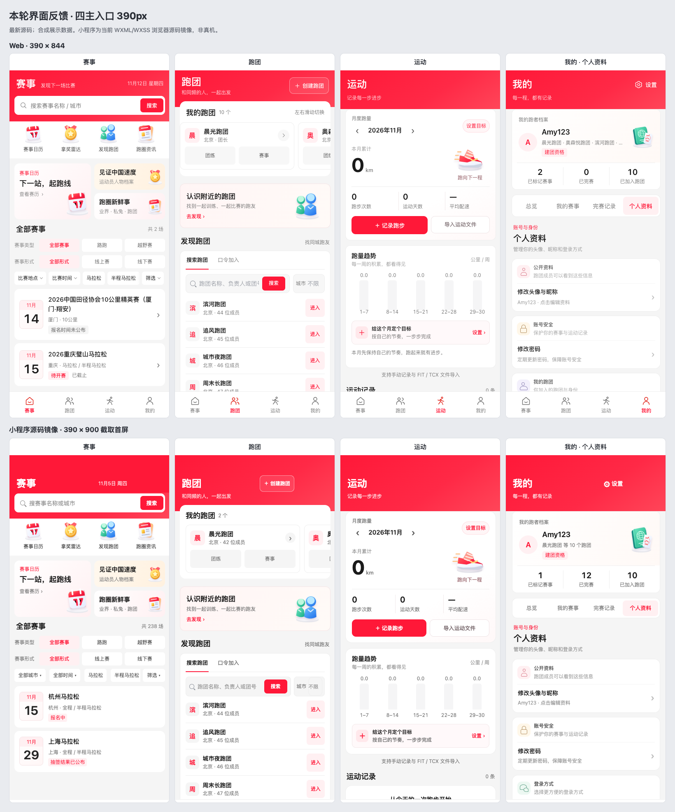
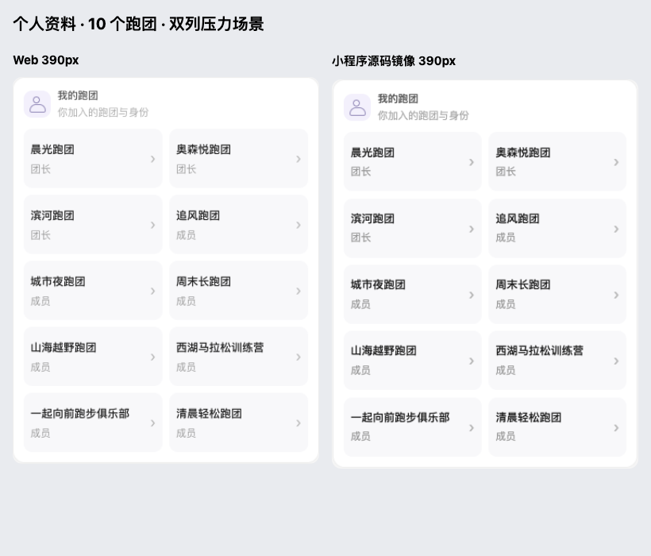

# 本轮界面反馈验收

本轮重新检查了最新源码的赛事、跑团、运动、我的四个入口，以及资讯搜索。展示内容均为合成数据，不写入业务数据库。

- 搜索：赛事、跑团、资讯按钮实际宽度均为 56px；红色按钮高度 34px，点击区域保留 44px。320px 下跑团搜索输入区仍有 105px，390px 下为 145px，未出现按钮挤满搜索框。
- 首页：搜索框下方重复赛事分类已移除；“全部赛事 / 路跑 / 越野赛”集中在下方赛事类型过滤，与赛事形式分行。
- 运动：月度跑量、三项统计与记录操作放在首张卡；趋势、目标独立成卡。Web 320px / 390px 下统计卡高 308px / 319px，记录入口距页面顶部 389px / 398px，可直接在首屏操作。
- 我的：四标签使用紧凑分段导航；资料区按公开资料、账号安全、登录方式分组。跑团身份使用双列卡片，10 个跑团在 320px / 390px 下每卡最小宽度 133px / 164px，包含长跑团名称，无内容溢出。

实际查看了下方两张对照图。四入口的按钮比例、统计层次与跑团卡片间距符合本轮调整目标。10 跑团截图为局部内容截取，截图时临时隐藏 Web 固定底栏以展示完整卡片；产品底栏未修改。

验证结果：

- Web 320px / 390px：8 个入口场景、12 项针对性交互通过。覆盖赛事/跑团/资讯搜索提交、跑团口令跳转、运动目标和记录编辑区展开、个人资料和密码编辑区展开；无横向溢出、坏图或浏览器异常。证据：[Web 报告](../design/previews/feedback-ui-review-20261111/web-report.json)。
- 小程序 320px / 390px：四入口 8 场源码镜像通过，额外断言搜索按钮尺寸、运动首屏操作、10 跑团双列和卡片溢出。证据：[源码镜像报告](../design/previews/feedback-ui-review-20261111/mini/report.json)。
- `npm run test:mini` 通过：53 个 JS、38 个 JSON、38 个 WXSS 校验通过，34 页 WXML 与 38 个 WXSS 原生离线编译通过。

小程序图片为当前 WXML/WXSS 的浏览器源码镜像，原生控件经过近似转换；原生离线编译通过，尚未代替微信真机视觉验收。
