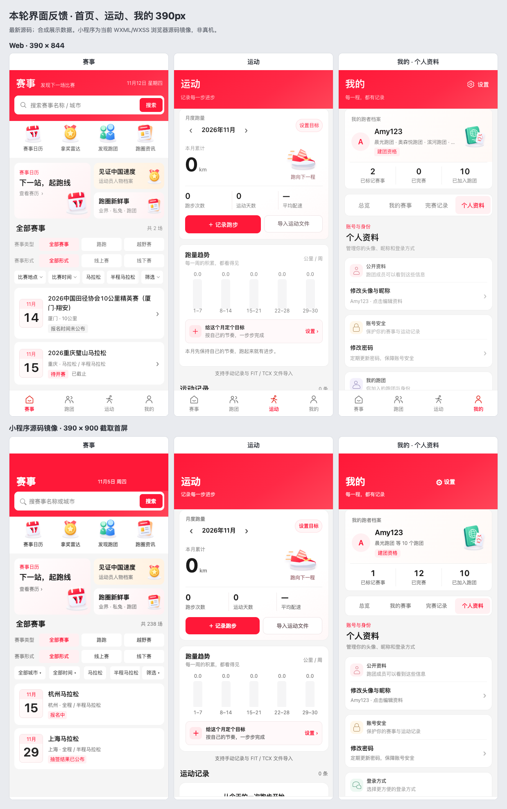
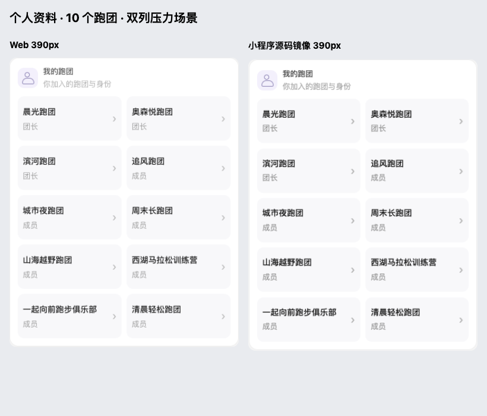

# 搜索、首页、运动和我的页面反馈验收

本 PR 只整理首页搜索和赛事过滤、运动页、我的页布局。产品源码限定为 Web 的 `Home.vue`、`Exercise.vue`、`Mine.vue` 与小程序 `races`、`sport`、`mine` 的 WXML/WXSS，不包含跑团主页面、性别筛选、资讯后台或账户体验数据脚本；无需新增全局样式依赖。

- 首页搜索按钮固定为 56px 宽、34px 红色视觉高度，保留 44px 点击区域。移除搜索下方重复的赛事分类，把“全部赛事 / 路跑 / 越野赛”放入下方赛事类型过滤，与赛事形式分行。
- 运动页把月度跑量、三项统计、记录与导入入口收进首张卡，趋势与目标独立成卡。320px / 390px 下首卡高 308px / 319px，记录入口底部距页面顶部 389px / 398px，首屏即可操作。
- 我的页使用紧凑四段导航，压缩赛事列表间距；个人资料按公开资料、账号安全分组，小程序另有微信登录方式卡。跑团身份改用双列卡，10 个跑团在 320px / 390px 下卡片最小宽度为 133px / 164px，长名称无溢出。

已检查以下两张当前分支生成的对照图。10 跑团图仅截取资料分组；截图时临时隐藏 Web 固定底栏，产品底栏未修改。





本分支基于 `origin/main` 的 `d4ad37b`，仅使用合成展示数据，不写业务数据库：

- `npm run build` 通过。
- 复用现有 Web review，收窄为首页、运动、我的：320px / 390px 共 6 个场景、6 项交互通过，覆盖搜索提交、目标与跑步记录编辑区展开、资料和密码编辑区展开。无横向溢出、坏图或浏览器异常。证据：[Web 报告](../design/previews/feedback-ui-review-20261111/web-report.json)。
- 复用小程序源码镜像，收窄为 `races`、`sport`、`mine`：3 个场景 × 320px / 390px 共 6 个视图通过，包含搜索尺寸、运动首屏操作和 10 跑团双列检查。证据：[小程序摘要](../design/previews/feedback-ui-review-20261111/mini/report.json)。
- `npm run test:mini` 通过：53 个 JS、38 个 JSON、38 个 WXSS 校验通过；34 页 WXML 与 38 个 WXSS 原生离线编译通过。

复现方式（本机启动 preview 后运行）：

```sh
npm run build
npm run preview --prefix web -- --host 127.0.0.1 --port 5188 --strictPort
MARATHON_PREVIEW_URL=http://127.0.0.1:5188/marathon node design/previews/feedback-ui-review-20261111/web-review.cjs
UI_AUDIT_OUT=design/previews/feedback-ui-review-20261111/mini MINI_AUDIT_ROUTES=pages/races/races,pages/sport/sport,pages/mine/mine MINI_AUDIT_FIXTURE=design/previews/feedback-ui-review-20261111/mini-fixture.cjs node design/previews/mini-ui-source-audit.cjs
node design/previews/feedback-ui-review-20261111/contact.cjs
npm run test:mini
```

小程序图片是当前 WXML/WXSS 的浏览器源码镜像，原生控件经过近似转换；原生离线编译通过，尚未代替微信真机视觉验收。本提交只保留两张重点对照图与简洁报告。
