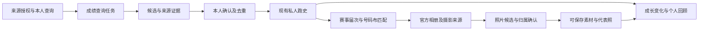

# 姓名证件号找成绩与赛事照片：MAKAKA 复核及实施方案

复核日期：2026-11-05，按本次会话日期。本文依据本轮公开网页读取、官网介绍图观察及本地代码审计；没有登录 MAKAKA 小程序，没有提交任何真实姓名、证件号、号码布或人脸查询。本文是调研与开发依据，所列新增接口、数据表和页面尚未实现。

## 1. 本次需求与当前缺口

用户重申的主流程是：**填写姓名与身份证号并授权 → 后台发现已参加的比赛和成绩 → 按比赛寻找官方相册、爱云动、跑步维生素的本人照片 → 自动整理到私人跑史。**

自动发现是主入口。截图识别、文件导入和手填继续作为补充，不能算作完成了这项自动查询需求。上一轮已实现的成长比较和个人回顾继续复用。

| 能力 | 项目当前真实状态 | 本次应补的内容 |
| --- | --- | --- |
| 中国马拉松数据 | `server/src/official.js` 仅同步公开赛事目录和详情 | 独立的个人成绩来源适配、查询任务和来源证据 |
| 我的跑史 | `server/src/race-history.js` 支持手填、OCR/文字/表格候选、核对、去重与私人保存 | 将真实外部查询结果接入同一候选确认流程 |
| 照片收藏 | 用户上传图片及继承原有私人收藏 | 赛事相册发现、本人照片候选、来源及预览/原图状态 |
| 网页及小程序 | “找回旧比赛”当前是资料导入 | 新增自动查找主流程、来源状态和查询进展 |
| 个人回顾 | 已有同口径 PB、进步、故事、标签和代表照片 | 接入新发现的成绩和照片，继续保留本人选择 |

不能通过增加一个身份证表单或模拟查询动画，把尚未接通的数据源标成可用。

## 2. MAKAKA 本轮直接核实到什么

[MAKAKA 官网](https://makaka.fans/)的[数字收纳介绍图](https://makaka.fans/image/collection.webp)展示个人 PB、个人赛事生涯、赛后自动整理成绩、轨迹、证书和赛事物料/照片，以及赛事日历与提醒。这次实际读取官网并查看介绍图；这些属于官方宣传，并未验证它的小程序实际效果、匹配准确率或后台实现。

[用户协议](https://makaka.fans/user.html)第 1.1 条将 MAKAKA 小程序与 makaka.fans 归于成都乐燃科技有限公司及关联公司。[隐私政策](https://makaka.fans/privacy.html)声明查询功能可能涉及第三方授权查询和姓名、身份证信息。它支持“以身份信息寻找第三方数据”这一产品判断，但没有公开足以让本平台接入的成绩提供方接口、摄影合作范围或覆盖清单。

官网两个域名的政策版本不同：fans 版标注 2025-06-01；[run 版](https://makaka.run/privacy.html)标注更新日期 2026-06-01，增加了设备关联等内容。不能把两版的日期或章节混用。run 域名本轮正常 TLS 校验失败，仅对无凭证公开文字临时忽略校验读取；没有修改本项目的证书策略。

上一轮文档记载的会员价格、28 场记录、多平台水印等是历史截图观察，本轮未取得原截图重新核实，不作为当前价格或当前实际覆盖的依据。

值得借鉴的是：围绕每次参赛，把散落的信息持续补齐，让用户少做整理。**“先发现比赛，再补成绩、证书与照片”是我方建议的实现顺序，不是已经探明的 MAKAKA 后台架构。**

## 3. 三类来源必须分别验证

| 来源 | 2026-11-05 实测事实 | 能支持的工作 | 尚不能确认 |
| --- | --- | --- | --- |
| [中国马拉松](https://www.runchina.org.cn/) | 本轮直接请求返回 HTTP 567，正文明确为 EdgeOne 安全策略拦截；它不是成绩表单的滑块；本项目已有赛事目录接口 | 保留现有赛事库，作为赛事届次匹配的基础 | 当前个人查询完整流程、可用服务端接口、覆盖年份、来源允许的接入方式 |
| 各赛事官网/计时服务商 | 上一轮有北京、厦门、上海的公开页面记录，本轮没有重新提交个人查询 | 作为全国来源缺失时的独立补充来源，逐项验证 | 不能从既有前端字段推定目前可稳定自动调用 |
| 赛事官方相册 | 按赛事届次寻找主办方公布的相册链接 | 建立同一赛事的官方媒体入口目录，注明实际服务平台 | 不能假设每场都有相册，或主办方官网本身存储照片 |
| [爱云动官方 FAQ](https://www.runnerbar.com/faq/) | 官方说明可按本人头像/参赛号码等查找；照片赛后陆续开放；原图及套餐规则随相册而定 | 赛事匹配后，按该场实际支持的方法寻找本人照片 | 第三方检索接口、站内预览/保存权限、原图费用 |
| [跑步维生素查照片页](https://www.runff.com/html/photo/find.html) | 页面有参赛号码、年份、赛事条件；公开 HTML 包含照片/视频项目目录 | 自动发现相册候选入口在技术上有公开元数据可研究 | 得到目录不等于得到本人照片、原图或第三方调用许可 |

跑步维生素本轮读取到 **2,608 个项目、2,608 个唯一项目 ID**。这是当次页面快照中的照片/视频项目数，不能说成平台覆盖 2,608 场独立比赛。其[官方前端脚本](https://cdnqy.chinarun.com/sites/1014/js/runff.js)使用 `s{id}.html` 的项目入口；实际访问了[西昌邛海湿地马拉松项目](https://www.runff.com/html/photo/s5692.html)和[大蜀道高光视频项目](https://www.runff.com/html/photo/s5674.html)，均可打开。

这一发现可用于下一步相册目录原型：读取公开项目元数据，匹配届次，给出准确项目入口。它仍然只是相册发现；没有查询任何选手照片。目录中存在视频项目和不以年份开头的名称，不能直接取名称前四位作为年份，也不能把同名第一项直接挂到个人跑史。

本轮未取得可供本平台集成的中国马拉松个人成绩、爱云动或跑步维生素开放接口与许可资料。这里表示尚未取得证据，不表示这些平台一定没有合作接口。[RUNFF 商业合作页](https://www.runff.com/html/hezuo.html)可作为联系入口，页面为历史内容，不能用于推定当前覆盖或报价。本轮没有对外发送联系消息。

## 4. 我们的产品重点

定位建议：**自动找回比赛，让跑者看懂自己的变化，留下自己的比赛回顾，并连接下一次参赛。**

| 设计位置 | 我方具体做法 |
| --- | --- |
| 找回比赛 | 自动查找优先；每个来源显示实际覆盖和进展，缺失时接续补录 |
| 跑史首页 | 用成绩变化、重跑赛事和本人选出的重要经历组织内容；显示时间轴及城市足迹 |
| 单场页面 | 先看成绩及与本人过去的关系，再看照片和自己的一句话；证书、奖牌等资料可展开 |
| 照片 | 同一场汇集不同来源，显示平台、匹配依据及原图状态；可选代表照、标记“不是我” |
| 成长 | 同项目、同计时口径比较；展示每次突破、同赛事历年对照；数据不足就说明缺什么 |
| 跑团与下一场 | 本人选择分享后复用已有战报；从往届回顾进入已存在的赛历和同场小队 |
| 视觉 | 沿用本项目红、白、浅灰，以时间、成绩和照片形成层次 |

这些方向中，故事、赛历、照片和成长展示也可能已存在于竞品。差异应落实为更少的用户操作、更可靠的成绩解释，以及与本项目跑团/赛历的连贯流程，不能只靠更换功能名来声称创新。

## 5. 用户旅程与完成状态

1. 在“我的跑史”进入“自动找回比赛”，先看到当前可用来源、需要的信息及查询范围。
2. 已接通的来源确需姓名证件号时，在本次查询中填写并授权；来源支持官方侧身份验证时使用其验证流程。没有可用来源时不先收身份证。
3. 后台建立独立任务；页面显示正在查哪个来源、已发现多少条、哪个来源需要本人操作。不能把查询失败显示成“没有跑过比赛”。
4. 查询结果形成候选，展示赛事、届次、项目、号码布、净时/枪时及来源。用户批量确认；冲突项单独展开。重复记录不覆盖本人更正。
5. 以已确认的“赛事届次＋项目＋号码布”寻找相册与本人照片；来源需要头像时再单独进入该项操作。身份证号不发给摄影平台作为通用检索键。
6. 相册入口、照片候选和已收藏照片分别展示。仅找到相册时写“相册已找到”；实际取得候选后才写照片数量。
7. 已确认内容立即进入跑史与个人回顾。证书或某平台照片未准备好，不阻止查看已经取得的成绩和素材。
8. 对支持后续查询的来源继续补资料，保留最近检查时间；新任务复用来源授权结果或重新验证，不能默认一次填身份证后所有平台就能永久同步。

页面进展以实际任务阶段及结果计数展示；没有来源返回的总量时不编造完成百分比。姓名证件号仅属于查询用途，按任务所需期限处理，不进入通用个人资料、URL、普通日志或跑团数据。

## 6. 在现有代码上增加什么

继续使用现有 Express、SQLite、网页和小程序；复用跑史候选核对、去重、删除防恢复与私人媒体访问，不另造一套个人档案。

需要新增的逻辑模型如下，表名是建议，尚未建表：

| 模型 | 必要内容 |
| --- | --- |
| `race_data_sources` | 来源类型、真实可用能力、验证日期、所需字段、覆盖范围、官方入口；支持目录发现不等于支持个人查询 |
| `race_discovery_jobs` / 来源子任务 | 所属用户、来源、阶段、结果数、错误、重试时间、取消/过期；普通任务表不放明文身份证 |
| `race_discovery_candidates` | 解析结果、来源原始记录 ID、取得时间、冲突、本人确认及归档结果 |
| `race_history_source_links` | 跑史与多个外部记录的映射；保留来源原值及本人修正，不静默覆盖 |
| `race_album_sources` | 按届次维护的官方/摄影项目入口、来源项目 ID、照片或视频类型、匹配依据和核对时间 |
| `race_photo_candidates` | 所属用户与跑史、来源照片 ID、匹配依据、预览/原图/购买状态、归属确认、忽略/收藏状态 |
| 已有 `race_history_media` 扩展 | 可保存素材的来源关联与使用范围；既有本人上传资料保持可读 |

任务按来源记录 `queued / running / action_required / succeeded / failed / cancelled / expired`，同时记录有效结果数。多来源任务可以部分成功；“来源正常返回零条”和“请求失败”是不同结果。取消任务后应停止后续查询与取图。

照片检索适配至少分别返回：赛事相册入口、本人照片候选、候选的可保存方式。来源只允许跳转时保留原站入口；允许返回预览时才能站内展示；原图需要购买时直接说明。`providerId＋externalPhotoId` 用于来源内去重；跨平台相似图片先形成待核对项，不仅凭相似度删图。

首批建议接口（均未实现）：

- `GET /api/me/race-history/sources`：返回当前真实可用的成绩和摄影能力。
- `POST /api/me/race-history/discovery-jobs`：按选定来源发起本人查询。
- `GET /api/me/race-history/discovery-jobs/:jobId`：查看阶段、分来源结果、待操作事项和候选。
- `POST /api/me/race-history/discovery-jobs/:jobId/confirm`：归档选中的成绩候选，并保存服务端来源证据。
- `DELETE /api/me/race-history/discovery-jobs/:jobId`：取消任务并清理任务所需的临时身份信息。
- `POST /api/me/race-history/:entryId/photo-jobs`：为已确认经历查相册和本人照片。
- `POST /api/me/race-history/:entryId/photo-candidates/:candidateId/decision`：确认归属、忽略或在允许范围内收藏。

现有 `/import/confirm` 由客户端提交候选内容，适合本人资料导入。新增外部查询确认接口应提交候选 ID，由服务端读取来源证据，不能允许客户端自行填写一个“中国马拉松”标签就获得该来源身份。

## 7. 实施顺序与验收

**第一步，做真实数据验证。** 优先核实中国马拉松/其成绩服务方可用的个人查询路径，取得可复现的请求、返回样本和接入条件；并行验证一个摄影来源。以本人已知的参赛记录核对，确认赛事、项目、净枪时间和号码布能否取得。当前未具备这份查询样本，不能预先承诺完成日期。

**第二步，补查询任务与成绩候选。** 仅开放通过验证的来源，接入已有跑史；网页和小程序提供同一条查询—核对—归档流程。截图和手填放在补充位置。测试来源可以验证任务机制，但验收时不能算真实数据接通。

**第三步，补赛事相册目录及本人照片。** 公开项目目录可先验证相册匹配；个人照片查询逐来源接入。官方相册与摄影平台可以指向同一服务，按真实来源关联去重。允许部分平台成功，也允许稍后补齐。

**第四步，用真实归档生成自己的成品。** 将已确认成绩、可用照片和本人感受接回现有成长页、个人回顾与自选团内战报。额外增加同赛事跨年比较时，需先有稳定的赛事系列/届次关联。

完成核心需求至少要通过以下验收：

1. 本人身份查询实际返回历史成绩，不靠预置数据、手填或上传截图模拟自动发现；明确实际支持的来源和范围。
2. 每条成绩保留来源及取得时间；净时/枪时不混用，同名异届和不同项目不误合并。
3. 同一来源重试不重复归档，多来源同场合并不覆盖本人故事、更正或照片；删除后不会重新同步恢复。
4. 用已确认经历找到正确届次相册；返回个人照片时展示实际匹配依据，可标记“不是我”，忽略后重复查询不再反复推荐同一候选。
5. 成绩、证书、相册、个人照片、原图分别记录状态；查到成绩不等于照片已全部找齐。
6. 验证零结果、需要来源操作、超时、来源故障、部分成功、重试、取消和账户切换，私人候选不串账号。
7. 查询身份信息不出现在 URL、普通日志、导出文件或团长视图；临时任务到期/取消后按设计清理。
8. 用跑者本人已确认的参赛清单作分母统计成绩发现率；按实际可核对的照片样本统计误匹配，不拿“返回多少条”宣称全量覆盖。

本轮交付是公开来源复核、现状审计及这份实施方案。**姓名证件号后台自动查询和第三方照片自动汇集仍未接通。** 下一次功能开发应先完成真实来源验证与一条端到端接入，再扩展来源，不能继续以资料导入功能代替该目标。

## 8. 用户提供准确查询入口后：滑块与实际接续路径

用户进一步提供[大众马拉松成绩查询页](https://www.runchina.org.cn/#/data-score/public-score/list)，并确认其普通浏览器能看到查询表单，验证码是**拖动滑块**。这是本轮用户侧观察，不是本地已经成功完成验证码或个人查询的证据。

本地两次不同方式的观察需要分开：

- 普通 HTTP 请求得到 HTTP 567，响应正文明确写明站点安全策略拦截。这是站点入口防护，不能将它描述成查询滑块，也不能因此判定所有正常用户都无法使用。
- 普通 Chrome/Playwright 未修改客户端标识访问一次，主文档 HTTP 200，但等待 2 秒时页面全白、无输入框、无 JS/CSS/API 加载；没有观察到真实查询前端。没有继续重新请求、伪装、切换代理或绕行。

**滑块是本人交互验证步骤。** 可研究和实现的接续方式，是本人在官网原会话完成验证，之后读取本人已显示的成绩；不伪造滑动轨迹、验证票据，不调用未经验证的接口。若产品要求用户离开后仍能在服务器持续查询，需要另外取得来源支持的服务端接口或授权机制，不能把浏览器验证码会话直接当成长期平台授权。

新增[本地成绩整理助手原型](../browser-tools/runchina-score-helper/README.md)：以 Chrome 扩展形式在用户已能正常使用的浏览器内，由本人主动点击读取当前页已显示的表格，输出已有跑史可核对的 JSON。它不要求把身份证交给本平台，不保存身份输入、会话或验证码，也不向外发送数据。还可输出不含身份和成绩的页面结构报告，用于核对未知布局及公开脚本域名。结构报告不是验证码校验协议抓包。

这是**验证后整理辅助**，不是滑块自动解题或后台自动查询。合成表格验证不能替代真实官网结果页验收；目前尚未读取到成功查询的官网结果，不能承诺它已适配实际布局，也不能断言一次验证就能取齐全部历史、自动翻页或下载全部证书。

已核实的官方技术/商务接洽线索：

| 一手入口 | 本轮可确认内容 | 需向对方明确的问题 |
| --- | --- | --- |
| [数字心动官网](https://www.shuzixindong.com/) | 官网说明赛后成绩查询、电子证书、影像和回顾等服务；公开商务邮箱 `kf@shuzixindong.com`，电话 `13552847590` | 是否提供本人授权的历史成绩服务；授权、验证码/会话流程、字段、分页、额度、费用、证书及后续更新方式 |
| [中国田协联系页](https://www.athletics.org.cn/contact/) | 马拉松业务 `010-87104291`，产业合作 `010-87181631` | 大众成绩库的数据服务方及第三方申请路径，是否可使用服务端凭证或来源认可的用户验证流程 |

数字心动官网客服与历史全国成绩页截图所列号码相同，只能作为联系线索，不能据此认定它已向第三方开放全国成绩 API。本轮未发送邮件或联系对方；未发现可核实 MAKAKA 具体成绩供应商、验证码处理方式或后台接口的公开材料。
