# 马拉松一站式平台：调研与产品方案

整理自数字心动、马拉马拉、Keep、咕咚、悦跑圈、最酷、爱燃烧、Strava 的公开资料，以及数字心动 App 截图。资料截至 2026-10-08。3.10 据 2026-10-21 的跑跑糖小程序截图，3.11 据同日的趣动小程序截图，3.12 据同日的趣动与闪动报名界面，3.13 据同日的喔图萌芽相册。3.14 至 3.17 是同日整理的跑团管理。3.10 至 3.17 已开发。跑量只记跑步和越野，先手填，跑表未接。报名页以 3.12 为准，相册页以 3.13 为准。第 5 节已做认证、物资、线下分账和联赛，不接支付。跑团功能的落地顺序以 3.18 为准。文末附参考来源。

## 目录

1. [总览](#1-总览)
2. [竞品调研](#2-竞品调研)
3. [功能方案](#3-功能方案)
4. [成绩数据与验证码](#4-成绩数据与验证码)
5. [跑团合作与激励](#5-跑团合作与激励)
6. [名额活动](#6-名额活动)
7. [合规清单](#7-合规清单)
8. [技术架构](#8-技术架构)
9. [路线图](#9-路线图)
10. [参考来源](#10-参考来源)

---

## 1. 总览

### 定位

以跑团为单位的马拉松选赛与组队工具。官方报名和成绩在数字心动、马拉马拉手里，团练工具咕咚已经做得不错；没人认真解决的是「这一场跑哪、和谁一起去、有没有机会拿奖」。从这里切入，再往赛后生涯、酒店、装备延伸。

### 行业数据

| 指标 | 数值 | 来源 |
| --- | --- | --- |
| 2025 全国马拉松 + 半马场次 | 594 场（全马 235、半马 359） | 中国田协《2025 中国马拉松赛事蓝皮书》 |
| 2025 参赛总规模 | 639.87 万人次 | 同上 |
| 中国田协 A/B 类认证赛事 | 341 场 | 同上 |
| 2026 北马中签率 | 约 12%（规模 3.2 万 / 报名 26.5 万，估算） | 北马新闻发布会 |
| 2026 上马中签率 | 6%（报名 38.19 万） | 上马官方公告 |

赛事集中在春秋两季：2025 年 4 月 105 场、3 月 103 场。场次最多的省份是浙江 46、山东 43、江苏 37。

### 用户旅程：每一步平台做什么

| 步骤 | 平台提供 |
| --- | --- |
| 1. 选赛 | 全国和海外赛历、报名倒计时、历年中签率、拿奖雷达、团友想跑哪场 |
| 2. 报名 | 合作赛事站内报名；其余跳官方通道；回来一键标记参赛状态 |
| 3. 组队 | 团内看谁报了同一场，自动建小队，拼房拼车、统一团服 |
| 4. 备赛 | 团练签到、品牌物资激励、跑鞋里程提醒 |
| 5. 比赛日 | 直播入口、天气、集合点、团友完赛速报 |
| 6. 赛后 | 证书导入、生涯时光轴与地图、团内战报、PB 海报 |

「选赛」和「组队」是现有产品最薄弱、也是本方案的切入点。

### 和现有产品拉开差距的三件事

- **跑团视角的赛历**：团里谁报了哪场、谁中签了、哪场能凑一队、谁需要拼房。现有产品的跑团功能集中在团练和排行，没有把「报名」这件事放到团里。
- **拿奖雷达**：把竞赛规程里的名次奖、年龄组奖、本地籍奖、破 3 奖、跑团赛中赛结构化，按 PB 或目标成绩算获奖概率和期望收益。公开资料里没看到有产品在做。
- **品牌与跑团撮合**：咕咚 2025 年和战马做「跑团能量计划」，说明品牌愿意给认证跑团送补给。把它做成常态化、出勤可核验的达标领取机制，替代押金。

> **关于中国马拉松官网的验证码**：不建议、也不会去做自动识别或绕过。2025 年修订的《反不正当竞争法》第十三条明确禁止以「避开或者破坏技术管理措施」的方式获取其他经营者的数据，而且查询要用完整身份证号。可行的替代是：用户自己查完后上传证书或截图导入、跑表数据自动识别比赛日、与赛事方和计时公司合作。详见第 4 节。

---

## 2. 竞品调研

### 竞品一览

| 产品 | 定位 | 核心能力 | 怎么赚钱 | 值得借鉴 | 短板 / 留给我们的空间 |
| --- | --- | --- | --- | --- | --- |
| 数字心动 | 中国田协认证的官方平台，中国马拉松官网的移动端 | 认证赛事报名（2022 北马官方报名与计时、2026 成都世遗马拉松报名通道、广马中签查询与中签海报）；认证赛事成绩聚合与证书下载；荣誉墙、影像墙、时光轴、生涯地图；「跑遍中国」线上赛点亮省份；直播；赛事住宿；2025 年起可自选参赛号 | 报名服务、线上赛、电商小程序「数字心动甄选」、品牌合作 | 生涯展示的信息结构；中签海报这类自带传播的设计 | 跑团和社交弱；成绩只覆盖认证赛事；单场赛事主页 10 个模块要用户逐个上传，实际大多空着 |
| 马拉马拉 | 2015 年上线的马拉松报名与泛运动票务平台 | 曾是北马等顶级赛事的官方移动端报名通道，2026 广马官方合作渠道；柏林、芝加哥等海外赛事报名；跑鞋装备管理（纸娃娃系统）；防作弊勋章；配速跑 | 报名服务、马拉多买商城、线上赛、滑翔伞潜水等体验票务 | 装备里程管理带出换鞋购买；海外赛事报名服务；福利名额 | 第三方评测提到部分机型闪退、客服响应慢、勋章判定不一致 |
| Keep | 泛健身，靠 IP 奖牌线上赛出圈 | 课程、会员、IP 奖牌线上赛、自有品牌器材与服饰 | 2025 营收 16.37 亿元：自有品牌 7.78 亿、会员及付费内容 6.80 亿、广告及其他 1.79 亿 | 奖牌设计和 IP 联名的传播力 | 会员及付费内容同比降 25.9%，财报归因于线上赛事收入减少，线上赛奖牌红利在退 |
| 咕咚 | 跑步起家的泛运动 App，跑团工具最完整 | 「跑团GO」小程序：团活动自定义报名项、审核、导出、付费活动；线上赛（排位、达标、目标）；活动实况看团友实时位置；认证跑团 | 会员、课程、品牌合作、官方赛事 | 2025 年与战马合作「跑团能量计划」，给认证跑团送饮料补给和装备包，正是赞助思路 | 重团练和线上赛，赛事选择与成绩生涯不是重点 |
| 悦跑圈 | 社交跑步，线上马拉松首创者 | 2022 年初 1.3 亿注册用户；线上马拉松（2015 年办 9 场，19.8 元报名寄奖牌）；跑团（团长需实名和身份证审核，一号一团）；中国跑团联赛 | 2022 年报道称广告是最大收入，另有赛事服务、电商、线上赛 | 跑团认证门槛；跑团联赛这类以团为单位的运营活动 | 报道称后来丢了两块核心业务、转向线下跑者服务站：只靠广告很脆弱 |
| 跑跑糖 | 以跑团为单位记跑量 | 个人打卡、跑表同步、日周月年榜、分组榜、月度目标、周月年报和导出。界面见 3.10 | 这批截图里「我的」有保单和收款中心，收费标准未在图中写明 | 跑量怎么计入、怎么排名、怎么出报表 | 保险和收款放在个人页。我们的跑量设计不收款、不卖保险 |
| 趣动 | 跑团日常活动报名 | 按期发团练，配速组、志愿者和非训练组分别报名；自评等级；活动说明、路线图和分享。界面见 3.11 | 图里出现水费、保险标签和「¥0 起报名」 | 一场团练如何分组、写计划和分享 | 水费和保险不进我们的活动。关注、私信、Pick 和运动搭子也不做 |
| 闪动 | 俱乐部活动报名 | 先填昵称、性别、手机号和级别，再选一个组提交；组内可报领跑员；名单按组展开。界面见 3.12 | 报名费、退款、运动保险、免责声明勾选，以及活动页广告 | 报名页先选组、名单上标级别、每组有领跑 | 不收集手机号和证件号，不收款，不卖保险，不放广告 |
| 喔图萌芽相册 | 活动照片直播和云相册 | 单独建相册，设置谁能上传、谁能看；照片和视频分栏；管理里可删除和审核；分享出海报。界面见 3.13 | 会员水印、AI 找我、AI 合影、云冲印 | 按一场活动收照片，宫格浏览，管理可删 | 相册跟着活动走，只对本团开放，不做人脸识别，不设会员功能 |
| 最酷 / 爱燃烧 | 赛事报名与成绩库 | 最酷：赛事按路线、服务、氛围打分，卖点标签（奖金加码、PB 赛道）；爱燃烧：成绩与照片认领，2017 年 10 月认领率 21.2% | 报名服务费 | 赛事评分和卖点标签可直接借鉴；成绩认领说明跑者愿意主动认领自己的数据 | 内容和社交较轻 |
| Strava | 海外跑者社交与训练 | 俱乐部周排行与活动、路段排行榜（Segment）、订阅；并入 Runna 后提供 AI 训练计划 | 订阅 | 团内周榜、路段赛适合做团内激励 | 国内赛事数据和支付生态缺位 |

### Keep 分业务收入（亿元人民币）

| 业务 | 2024 | 2025 | 变化 |
| --- | --- | --- | --- |
| 自有品牌运动产品 | 9.54 | 7.78 | -18.4% |
| 线上会员及付费内容 | 9.18 | 6.80 | -25.9% |
| 广告及其他 | 1.94 | 1.79 | -7.5% |
| 合计 | 20.66 | 16.37 | -20.7% |

来源：Keep 截至 2025-12-31 年度业绩公告。会员及付费内容下降主要来自线上赛事收入减少。

### 从调研里得出的判断

1. 官方报名通道和认证成绩是数字心动、马拉马拉的护城河，不正面抢，做报名前后的决策与组织。
2. 咕咚的跑团GO 证明团长愿意用小程序管活动；咕咚和战马的合作证明品牌愿意给跑团送物资。赞助撮合可行。
3. 线上赛奖牌在退潮，不把它当主收入。
4. 纯广告模式脆弱，收入要挂在交易上：酒店、装备、赛事服务、品牌撮合。
5. 规程里的年龄组奖、本地籍奖、破 3 奖、跑团赛中赛分散在 PDF 里，没人整理，拿奖雷达有机会独占。
6. 生涯展示要「自动填」才有人用：证书 OCR、跑表识别、团友互传照片，而不是让用户逐格上传。

---

## 3. 功能方案

### 板块总览

第一版主线是前五个板块；其余板块第一版只做最轻的形态。

| 板块 | 解决什么 | 第一版做到 | 后面再做 |
| --- | --- | --- | --- |
| 赛事库与日历 | 全国乃至全球赛事好找，报名节点不再错过 | 国内 A/B 类认证赛事、热门 C 类、七大满贯与热门海外赛；报名开启、抽签、缴费截止订阅提醒 | 全量 C 类、越野与铁三、赛事评分、往届数据 |
| 我的赛事生涯 | 所有已跑比赛一处看 | 时光轴、生涯地图、荣誉墙、单场赛事主页；手记成绩可附证书或奖牌照片，识别位置尚未开通 | 跑表自动识别比赛日、团友互传照片、年度报告 |
| 报名与参赛状态 | 报名分散在各个平台 | 跳转官方报名 + 手动标记参赛状态；我的赛历与冲突提醒 | 合作赛事站内报名、跑团集体报名 |
| 跑团 | 团里谁跑哪场、团练怎么组织 | 搜跑团或口令加入；建团由后台审核；团内赛历、同场小队、活动、签到、组别、积分礼品；团长在手机上管成员。详见 3.9。认证、物资、线下分账和联赛已做，不接支付，会费仍不代收 | 赛中赛组队、团长数据报告。跑量见 3.10，活动字段见 3.11，报名页见 3.12，相册页见 3.13，会费见 3.14，成绩统计见 3.15，约跑见 3.16，队内赛见 3.17。落地顺序见 3.18。会费、成绩统计、约跑、队内赛、报名页、相册页和跑量已开发。跑量只记跑步和越野，跑表尚未接入 |
| 拿奖雷达 | 按成绩找有机会拿奖的比赛 | 管理员按来源录入奖项和往届名次成绩，对照 PB 或目标成绩。没有往届成绩时不估算概率。天气和赛道修正留位置，尚未开通 | 期望收益扣成本、新赛事自动匹配 |
| 激励与赞助 | 团员坚持出勤，品牌找到跑者 | 品牌物资池 + 达标领取（不碰用户资金）。已做领取和线下分账记账，用户不付钱 | 装备打卡返还、微信支付分免押借用、跑团会员包 |
| 名额活动 | 热门赛事一签难求 | 管理员按来源录入历年报名人数和名额，页面算出比例；没有录入就不显示。中签后可复制卡片并保存图片。截止和缴费仍走现有提醒 | 与赛事赞助商合作的名额评选或抽签 |
| 直播与亲友追踪 | 比赛日看直播、看团友 | 直播信息聚合（平台、时间、入口） | 合作赛事实时成绩推送、团友完赛速报 |
| 社交 | 赛记与交流 | 跑团内动态、评论和点赞。只有本团能看，不加积分 | 公开社区、赛事问答、关注 |
| 商城 | 跑鞋、能量胶、装备 | 我的页留装备位置，跳转尚未开通 | 自营、跑团团购、跑鞋里程到期推荐 |
| 酒店与出行 | 赛事周酒店难订、涨价 | 赛事页留订房位置，尚未开通，不显示房价 | 赛事周边酒店直签跑者权益、跑团包房 |
| 训练 | 备赛计划 | 运动页留位置，标成尚未开通，不排课 | 按目标成绩生成训练计划，接跑表数据 |

### 3.1 赛事库：每场赛事存什么

| 字段组 | 内容 | 来源 |
| --- | --- | --- |
| 基本 | 名称、届次、日期、城市、起终点、项目（全马 / 半马 / 10K / 越野）、规模、中国田协认证等级、世界田联标牌 | 中国马拉松官网赛历、赛事官网、世界田联标牌赛日历 |
| 报名 | 抽签还是先到先得、报名起止、缴费截止、费用、资格（成绩门槛、年龄）、官方通道（官网、小程序、数字心动、马拉马拉）、二次抽签 | 竞赛规程、官方公众号 |
| 赛道 | 关门时间、爬升、PB 赛道标签、补给点 | 规程、赛道图 |
| 奖励 | 总名次奖、中国籍奖、本地籍奖、年龄组奖、破 3 奖、跑团赛中赛；计时口径（枪声 / 净计时）、录取名次、金额、能否叠加 | 竞赛规程 PDF，大模型抽取后人工复核 |
| 往届 | 规模、各组别第 N 名成绩、完赛率、天气 | 往届成绩公示，只存名次和成绩，不存姓名 |
| 直播 | 平台、时间、入口 | 赛事官宣 |
| 周边 | 酒店价格、交通、天气预报 | 酒店分销接口、天气接口 |
| 口碑 | 路线、服务、氛围评分，跑者赛记 | 平台用户 |

冷启动：人工加大模型整理 2026–2027 年国内认证赛事和七大满贯，每条记录带来源链接和更新时间。其他报名平台只当发现线索，不整页搬运。全球赛事可参考 Ahotu（收录约 6.7 万场跑步赛事）和世界田联标牌赛日历，同样只取公开事实并标注来源。

### 3.2 参赛状态与提醒

状态：想跑 → 已报名 → 待抽签 → 中签 / 未中签（候补）→ 已缴费 → 已领物 → 完赛 / 未完赛 / 弃赛。

状态由用户手动标，或由合作赛事回传。时间节点触发订阅消息：报名开启前一天、报名截止前一天、出签当天、缴费截止前一天、领物开始、比赛前一天（天气与集合点）。我的页已留微信提醒的位置，标成尚未开通。页面上的截止提醒仍然会列出。两场全马间隔太近时给出冲突提醒，间隔阈值可配置。

### 3.3 报名分三档

| 档位 | 适用 | 用户体验 | 前提 |
| --- | --- | --- | --- |
| 站内报名 | 已签约的合作赛事 | 在小程序内填报名信息并付费，状态自动同步 | 赛事主办方授权或合作协议；「体育-体育赛事」类目；实名信息直接交给赛事系统 |
| 跳转官方报名 | 有官方小程序或网页报名的赛事 | 点按钮跳到官方小程序（微信要求用户点击并确认），回来后询问「报上了吗」 | 无需合作；拿到对方小程序 AppID 或链接即可 |
| 手动标记 | 其余所有赛事，含海外 | 选赛事、标记状态，可附报名成功截图 | 无 |

赛事页已留站内报名和付款的位置，标成尚未开通。不填写身份证。现在仍打开赛事自己的页面。打开官方报名后，页面问「报上了吗」。点「报上了」，还没标状态或只标了想跑时，记成已报名；已经标成后面的状态时保持原样。标了状态可以附一张报名截图，不识别截图上的字，只有自己能看。同一场可以只去掉一个项目的成绩。

### 3.4 我的赛事生涯（对标数字心动）

- **我的页**：完赛场数、足迹（省 / 市）、半马和全马 PB、本年跑量。
- **时光轴**：按日期排列，每场显示成绩、PB 标记、封面（证书或照片），可按路跑 / 越野 / 其他筛选。
- **生涯地图**：点亮城市和省份，按年份筛选，下方赛事卡片横滑。
- **荣誉墙**：证书、奖牌按年份分组，线上赛单独一栏。
- **单场主页**：成绩、距离、配速；我的故事；证书、奖牌、照片、视频、轨迹、号码布、参赛服、参赛包、完赛包。

比数字心动多做一步，自动填：

- 证书 OCR 一次解析出赛事和成绩。成绩旁已留识别位置，标成尚未开通。照片可以留下，成绩仍由自己填写。
- 同场团友上传的照片按号码布分发（人脸识别属于敏感个人信息，需单独同意）。
- 奖牌、参赛服、参赛包按赛事共享一份官方图，用户只需点「我也有」。

### 3.5 拿奖雷达

规程里的奖项远不止前八名。公开资料里的例子：

- 郑开马拉松：年龄组男女前 10 名每人 500 元，代扣 20% 个税。
- 唐山马拉松 2025：5 个年龄组，男女各前 8 名有奖金。
- 广安马拉松 2026：全马名次奖到第 20 名，另有本地籍特别奖、跑团赛中赛、男子破 3 / 女子 3:15 文创奖。
- 淮安马拉松 2026：跑团团体成绩前 3 名有团队奖金。
- 无锡马拉松 2026：大众选手男女前 3 名单独设奖金。

| 环节 | 内容 |
| --- | --- |
| 输入 | 性别；比赛当日年龄（只要出生年月）；户籍省份（判断本地籍奖）；PB 或目标成绩；可出行范围和日期；是否注册运动员 |
| 数据 | 结构化奖项（类型、计时口径、录取名次、金额、能否叠加、资格限制）；往届各组别第 N 名成绩；规模变化；比赛日气温 |
| 计算 | 获奖概率：预期成绩跑进往届第 N 名成绩的概率，用历年阈值的均值和波动，加上个人发挥波动估算。期望收益：概率 × 税后奖金，同类不叠加取最高，再减报名费、路费、住宿 |
| 输出 | 按期望收益或获奖概率排序，每条写明理由，例如「40–49 岁组净计时前 8 名，往届第 8 名比你的 PB 慢约 4 分钟」 |

报名人数、天气、规程年年变化，页面必须标「仅供参考」，不能写「保证获奖」。

这一版已做对照。管理员在赛事里按规程添加奖项，来源必填。往届第 N 名成绩也要另写来源，没有这份成绩时只列出奖项，不估算概率，不算期望收益。页面留着天气和赛道修正的位置，标成尚未开通，对照仍用已记下的成绩和往届名次。用户自己填性别、出生年月和省份，用来对年龄组和本地籍，不收身份证。出生月份和比赛月相同的，按小一岁算。目标成绩空着就用已记下的 PB。跑团奖单独标出，不按个人成绩排。税后金额按填写的税率算。

### 3.6 直播与亲友追踪

直播只做信息聚合：平台、时间、入口。微信里只有与小程序同主体或关联主体的视频号能直接拉起直播（`wx.openChannelsLive`），其他平台展示链接或提示打开对应 App。自建直播要「社交-直播」类目和视听许可证，不建议做。选手实时追踪由赛事计时系统提供，合作赛事可接入，非合作赛事跳官方追踪页。

### 3.7 社交

先做跑团内的动态、评论、点赞，封闭圈子审核压力小。开放社区要「社交-社区论坛」类目，文字图片先过微信内容安全接口再人工抽检。不做「分享得奖励 / 得次数」，微信把这类判为诱导分享。

这一版已做跑团内的动态、评论和点赞。只有本团成员能看。点赞和评论不加积分，分享也不增加次数。

### 3.8 商城与酒店

- **商城**：先走联盟分佣，跑鞋、能量胶跳京东或品牌小程序，不碰库存。我的页已留装备位置，标成尚未开通，不卖货，也不收款。跑鞋里程管理（马拉马拉做过）能自然带出换鞋推荐。
- **酒店**：先接美团联盟（酒店属于到店业务，接口直接返回小程序跳转路径）或携程分销（第三方整理的政策是国内酒店 4% 起、每间夜按 600 元封顶计，以官方为准）。赛事页已留订房位置，标成尚未开通，不显示房价，也不跳转。中签当天推「先订可免费取消的房」。
- **后续**：与赛事周边酒店直签跑者权益（延迟退房、提前早餐、行李寄存），支持跑团包房。

### 3.9 跑团：现在的用法

记于 2026-10-19，是已经上线的用法。第 5 节的认证分级、物资池、线下分账和联赛已做，不接支付，不收身份证。会费仍不代收。

H5 和小程序底栏都是首页、运动、跑团、我的。运动页放这个人自己的跑步和越野，先手填。跑表列出高驰、佳明、华为，标成尚未接入，没有绑定按钮。训练计划同样留着位置，标成尚未开通，不排课。团练打卡仍在跑团里。正在报名的赛事从「我的」进「报名中」，不再单独占一栏。

后台列表的搜索按输入的片段匹配，写几个字就会筛选，不必写全称，空格也不影响。赛事匹配名称、城市、地点和省份；用户匹配昵称；跑团匹配团名、团长和成员昵称；官网赛历匹配名称、城市和省份。搜索时页面只留下匹配到的条目。赛历搜索不再套用即将开赛，并收起官网赛历；官网搜索先列出日期、城市和名称，点开一行再看这场的详情。用户详情里的参赛记录同样按名称或城市的片段筛选。点「查官网」仍用搜索框里的这段文字向中国马拉松官网查询。

赛历首页和小程序的赛事搜索同样按名称、城市、地点或省份的片段匹配，写几个字就列出，不再套用当前的分类、时间和状态。结果只保留日期、城市和名称。

后台编辑赛事按基本信息、项目、报名、官网、比赛日、规程、直播分节填写。报名日期留空则保持原值；修改日期须填写本次来源。未填写报名时间的新赛事，赛历显示「报名时间未公布」。

中国马拉松官网上还没开赛的场，可以由 Grok 读完公开页面后上传。上传先停在后台「待审详情」，不会直接改赛历。已经发布的场要人工看过：合格再确定发布，不合格写下原因打回，上传方按原因改完再传一次。空着的报名时间、费用和链接不会盖掉已经记下的。报名时间没在页面上看到就留空，赛历仍显示「报名时间未公布」。

用户用昵称和密码登录，不收集手机号，也不收集身份证。我的页有登录和注册。登录要填图片验证码，密码至少 8 位。退出之后，这台手机不再是这个人；换手机用同一个昵称和密码，会回到原来那一个。我的页会标出「建团资格」，并列出自己的团和团里的角色。修改密码不在登录后展开，收在账号卡片的「修改密码」里，点开后再填写当前密码和新密码，位数要求写在新密码下方。尚未设置密码的账号，同一处为「设置登录密码」。

以前只填过昵称、还没设密码的人：如果这个昵称只有一个，注册时会把密码设在原来那个人身上，团长和跑团都还在。如果有好几个同名，注册会提示昵称冲突，不会再新建一个，也不会猜是哪一个。管理员可为保留的账号设置登录密码，也可删除多余账号。删除后，若保留的账号尚未设置密码，本人再次注册时将设置在该账号上。若该用户仍担任跑团团长，须先完成团长移交后方可删除。用户详情中的参赛状态可按状态、赛事名称或城市筛选。点开用户列表中的一行查看详情；编辑与删除在该行右侧，删除在列表中确认。后台可添加用户：填写昵称和登录密码后即可登录。昵称已存在时不新建，改为在列表中编辑该账号。

跑团页先是加入，已经加入的团在中间并写明角色，创建跑团在最下面。只有已开启建团资格的人，下面才会出现创建表单。

加入时两种方式选一种，页面上一次只留一个输入框。

| 方式 | 怎么用 |
| --- | --- |
| 搜跑团 | 默认。边输入边列出来，不用再点搜索。跑团名以输入开头的排在前面，团名里含这段字、以及团长或跑团管理的昵称也能对上。一次先显示 6 个，写明还有几个，点一下可以全部展开。搜索时不显示已加入的团、统计和创建表单，一行一个，写出人数和团长，申请后等这个团的团长或跑团管理通过。普通成员的名字搜不到，结果里也不出现口令。 |
| 用口令 | 填微信群里的口令，马上进团。 |

创建跑团要先有建团资格，再等审核。后台开启建团资格之后才能提交；已经担任过团长的人默认有这个资格。关闭建团资格后，不能再申请建团，已担任团长的跑团不受影响，团里的角色也不会变。同一个团长可以建多个跑团，一次只能有一个在审核，通过或拒绝之后才能再交下一个。提交之后，管理员或跑团管理员在后台审。通过后这个团才出现，申请人是这个团的团长，可以在手机上管成员、入团申请、活动、组别和礼品。拒绝后可以再交。只有团长能改团里的角色，也可以把团长交给别人，自己变成跑团管理。后台同样如此：现任团长不能直接改为跑团管理或成员，须先将团长移交给本团其他成员。后台有跑团列表，可按跑团名称、团长或成员昵称查找。点开后可查看口令、按昵称添加成员、移出成员，并指定团长。指定团长后，原团长改为跑团管理，新团长具备建团资格。现任团长须先移交，才能修改角色或移出。移出成员不删除其账号。后台可删除跑团：成员账号保留，建团资格也不收回；该团的成员关系、活动、积分、礼品和入团申请一并删除。

团里的角色是团长、跑团管理、成员。后台另有管理员和跑团管理员。跑团管理员审入团和建团，改用户在团里的角色，也能改自己的密码。赛事、账号、跑步记录和商城仍只有管理员能改。

团练签到只记今天谁到了，不记公里，也不因此加积分。活动可以写说明和这场积分：人数够，且每人打卡不少于这场里程，才各得积分。礼品用团里的积分换，不付款，不卖保险，不收身份证。个人跑量和团内跑量榜是另一套账，已按 3.10 做了，只记跑步和越野。签到不改成跑量，跑量也不加积分。日常团练的字段、报名页和相册已按 3.11 至 3.13 做了。会费、成绩统计、约跑和队内赛已按 3.14 至 3.17 做了。落地顺序见 3.18。赛事页已经能记下成绩，跑团的比赛一栏会显示团内成绩。

### 3.10 跑团跑量：参照跑跑糖

记于 2026-10-21，依据跑跑糖小程序截图。第四步已做手填，类型只有跑步和越野。跑表尚未接入。游泳、骑行、健身、球类这一版不做。

记录记在人身上。这个人在几个跑团，每个团用自己的规则决定这场算不算进本团的公里、排行和报表。团练签到继续只记到场，不加公里，不加积分。跑量不加积分，不收款，不卖保险，不收集身份证、手机号和邮箱。

同一批截图里还有建团知情同意、入团审批、消息、企业微信登录、修改昵称、跑团排序、解散跑团、保单、收款中心和打卡海报。那些不进这次跑量设计。

#### 图里的跑量是怎么串起来的

首页先给这个人自己的数，再给他所在跑团的数。今年 1242.81 公里，打卡 73 天、107 次。本月圆环是月度目标的完成度，图上是 81%。本月 163.26 公里，7 天 9 次，用时 13:20:21，跑步平均配速 4:54。下面两个动作是「运动打卡」和「设立 flag」。跑团卡片把总跑量写成 61.5 万、总打卡写成 4.6 万，并标出自己在团里的名次。

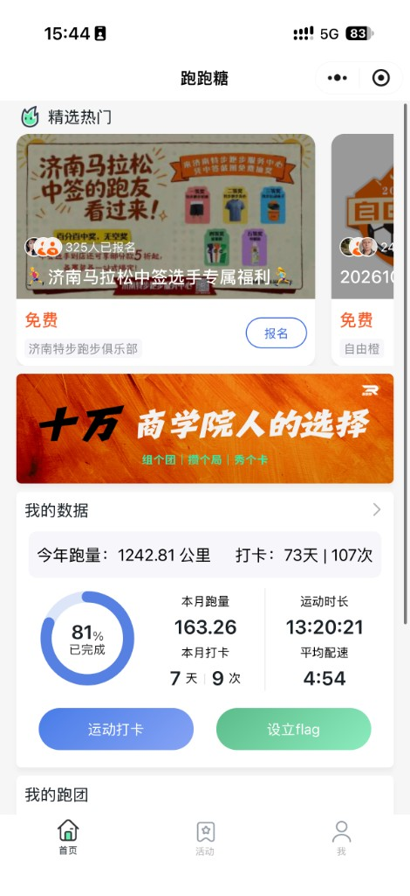

「我的」把今年、累计和所选月份再列一遍。图上累计 1546.46 公里、131 次，高于今年，说明累计跨年。月份可以换。同页还有保单、收款、跑鞋和教练入口，跑量设计不带这些入口。

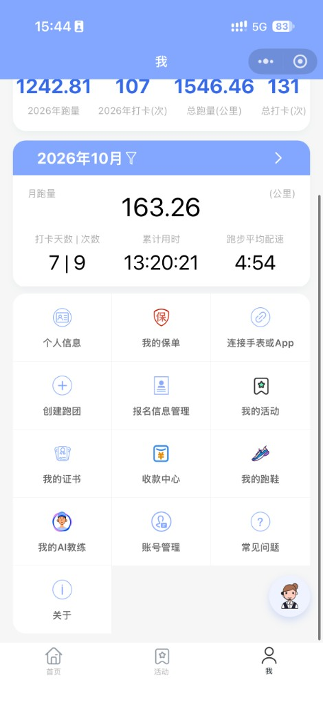

一条记录同时有跑量、里程、配速、用时和爬升。图上这场跑步是 42.44 公里，用时 03:12:44，配速 4:32，爬升 121 米，跑量和里程相同。展开后还有平均心率、最大心率、平均步频、最大步频和消耗热量。来源写「同步自 高驰」，并带同步时间。类型和城市可以改，本人可以删除。心率、步频和热量只在跑表同步的记录上出现。

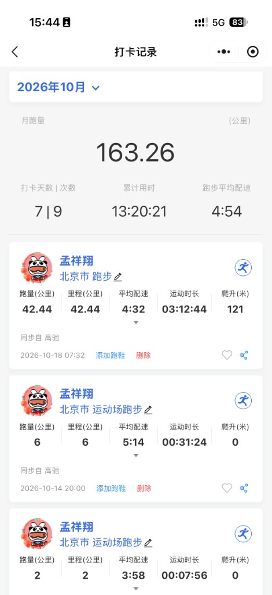

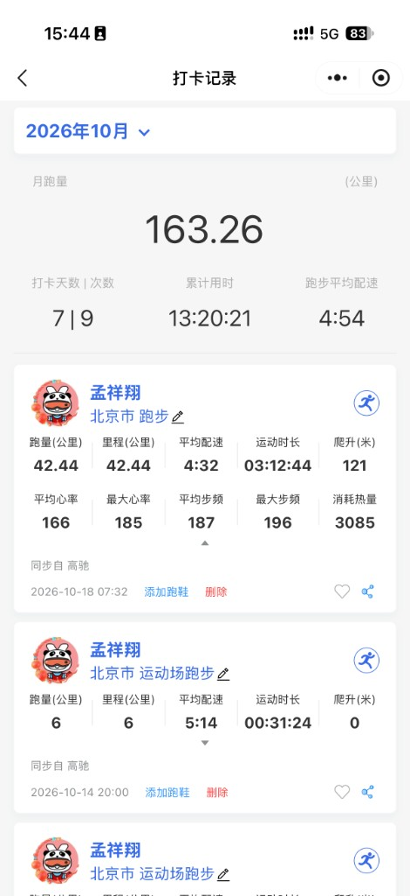

跑量和里程在这场相等，爬升另列，没有加进公里数。规则里的「跑量是否累加爬升」放在越野一节，不放在跑步一节。因此跑步的跑量等于里程；爬升折算只准备给越野用。图里没有写出 1 米爬升折多少公里。

进了跑团，先看三块：排行榜、分组榜、今日动态。时间范围是今日、本周、本月、今年、累计。今日从当天 0 点起算。累计的说明是「加入跑团后累积的总跑量」，入团之前的场次不在里面。个人页的累计可以大于本团累计。榜上能按名字搜。前三名用名次符号，后面用数字，每人带自己的跑量分组。

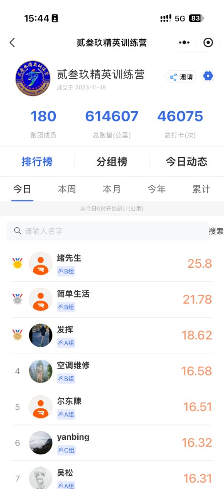

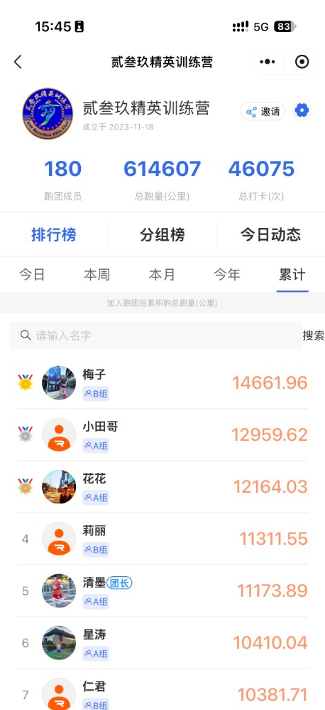

分组榜把同一分组的公里加在一起。图上今日是 B 组 290.48、A 组 241.13、其他 59.7、C 组 58.9。分组在管理里单独建：名称必填，最多 20 个字符，一个汉字占 2 个；人数 0 表示不限；编号只用来排序。

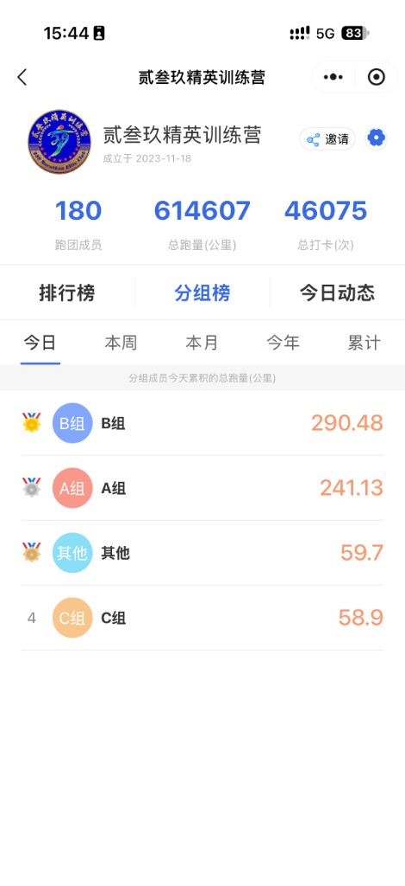

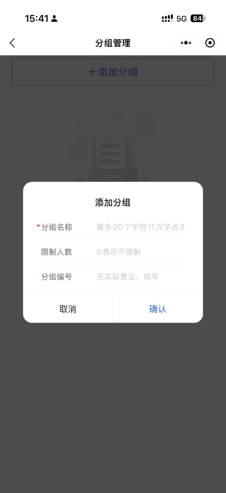

今日动态是一条条记录。图上能看到里程、配速、用时、爬升、心率、步频、步频峰值、热量，以及来源（佳明中国）。每条有「质疑」。质疑是成员对这条记录提出疑问，图里没有展示随后的处理页。

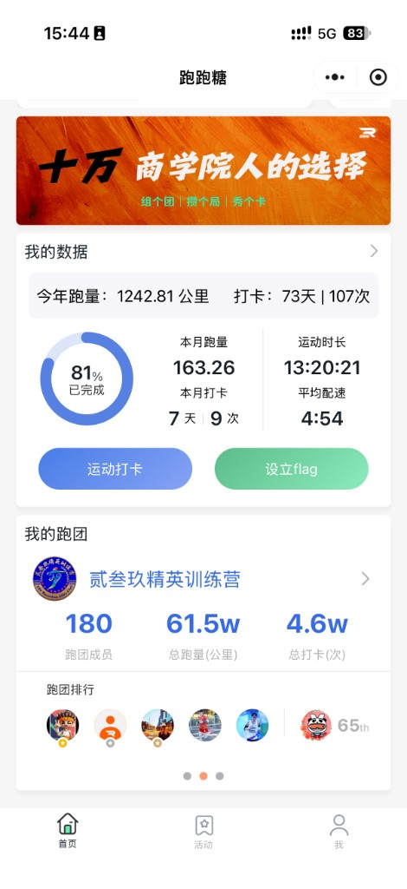

报表有周、月、年。周的例子是 10-19～10-25，2026-10-19 是周一，10-25 是周日。列是排名、姓名、跑量、天/次数、时长、配速，底行是合计。月报多一列 Flag，合计行的 Flag 是「-」。年报可以换年份。三张报表都说明：平均配速只算类型为跑步的记录；时长去掉秒，12:23 表示 12 小时 23 分。月报再说明合计行只加打卡次数，不加天数。个人页的「7 | 9」才把天数和次数分开。

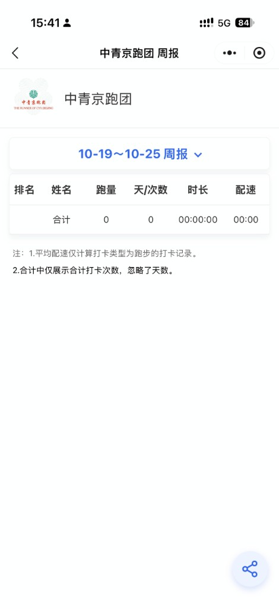

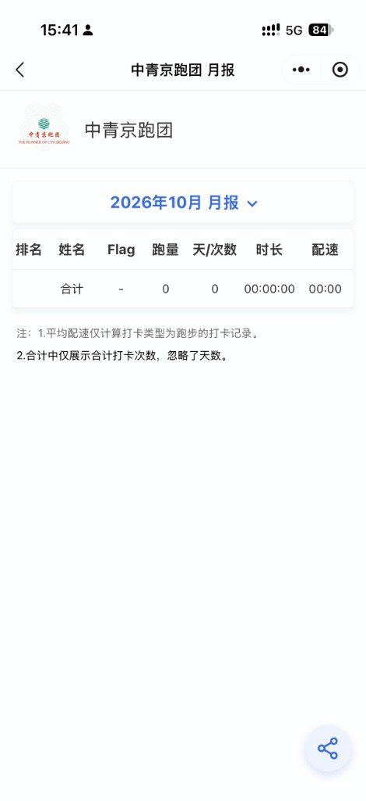

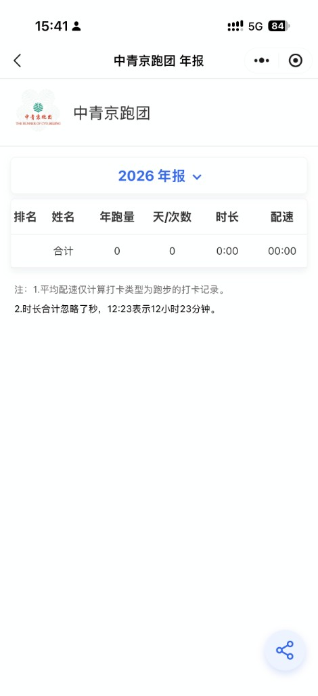

团长设置的规则决定一场能不能进这个团。图上的值如下。

| 项 | 图上的值 | 从位置看出的含义 |
| --- | --- | --- |
| 生效时间 | 2026-10-01 | 规则从这一天起用。页底写明不建议频繁改 |
| 允许手工截图打卡 | 开 | 没有跑表时，可以手填，并带一张截图 |
| 跑步最短 / 最长 | 1 / 128 公里 | 超出这段的跑步不按合格记录处理 |
| 跑步最快 / 最慢配速 | 3:00 / 15:00 | 配速是每公里用时，快过 3 分钟或慢过 15 分钟的不计 |
| 越野 | 开 | 单独一套门槛：最短 5 公里，最低爬升 100 米 |
| 跑量是否累加爬升 | 开，位于越野一节 | 只影响越野。跑步这场的跑量仍等于里程 |
| 游泳 | 关，最短 0.2 公里 | 关掉的类型不进本团 |
| 骑行 | 关，最短 3.5 公里 | 同上 |
| 健身 | 关，最短 30 分钟 | 单位是分钟，不能加进公里榜 |
| 球类 | 关，最短 30 分钟 | 同上 |
| 月度 Flag 下限 | 女生 10 公里，男生 10 公里 | 这是团规定的最低目标，个人还可以定得更高 |
| 当月加入自动观摩 | 开 | 本月才入团的人，这个月不按未达标算 |
| 惩罚措施 | 关 | 图上没有写出罚什么 |

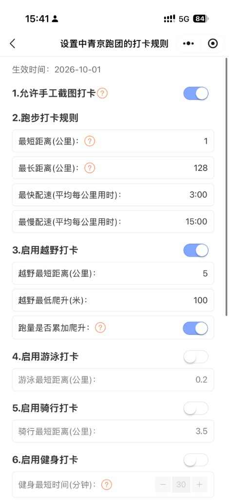

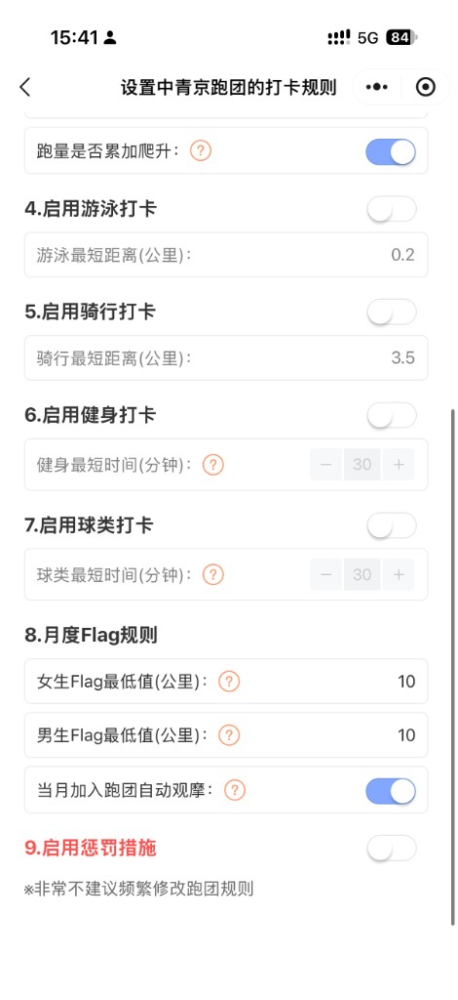

导出在跑团管理里。可选个人跑量或成员信息；时间按周、月、年、累计或自定义；月下面还有上月、本月、自定义。没有打卡的成员可以选择不导出。表格可以隔行着色。发送方式要求先绑邮箱，导出可能要几分钟。

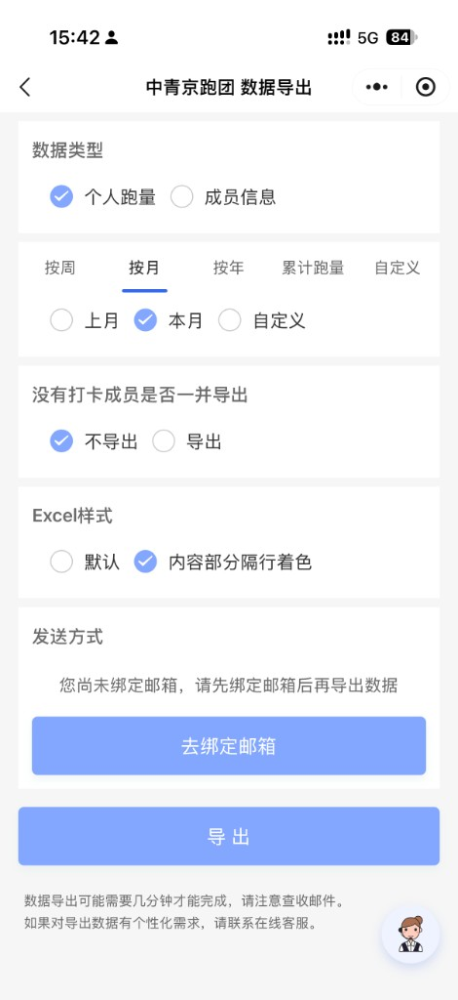

跑表列表里有高驰、佳明、颂拓、华为运动健康、博能、OPPO 健康、跃我，下面还有未看全的一项。高驰标成近乎实时，并有手动「同步」。同步到的最新一条是 10-18 07:32。

绑定说明在各品牌页上是同一套：

- 一个跑表账号只能绑一个跑跑糖账号。
- 一个人同时只绑一个第三方账号。已经绑了高驰时，佳明、颂拓、华为都不能再绑，页上写「已绑定【高驰】」。
- 同步的类型是跑步、越野跑、游泳、骑行，并且要符合平台的基本打卡要求。
- 只同步绑定之后产生的数据。点「同步」时，从当天 0 点再拉一次。
- 跑表账号改了密码，要重新绑定。
- 佳明和颂拓分中国区和国际区，大陆账号走中国区。
- 华为要先在运动健康里打开第三方服务，并打开「同步运动数据到云」。苹果和安卓的入口不同。华为可能漏推，一小时没有新记录时，打开小程序再点一次同步。

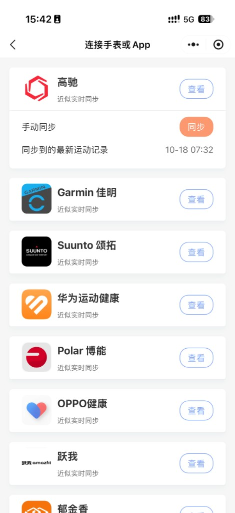

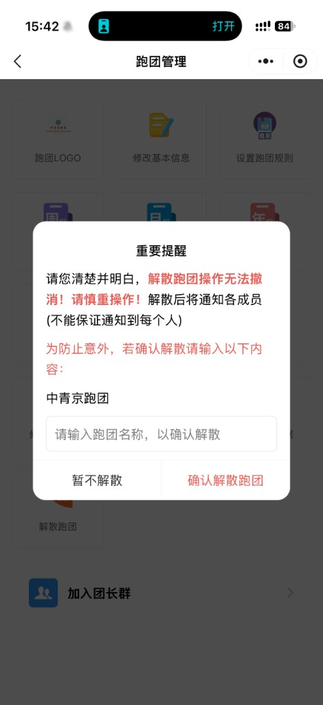

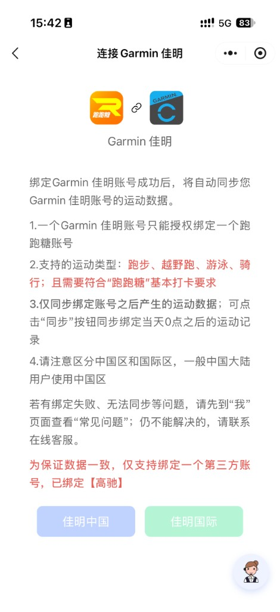

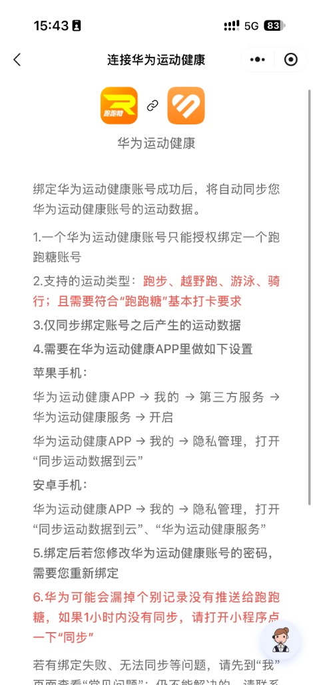

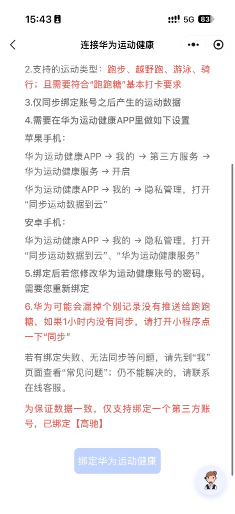

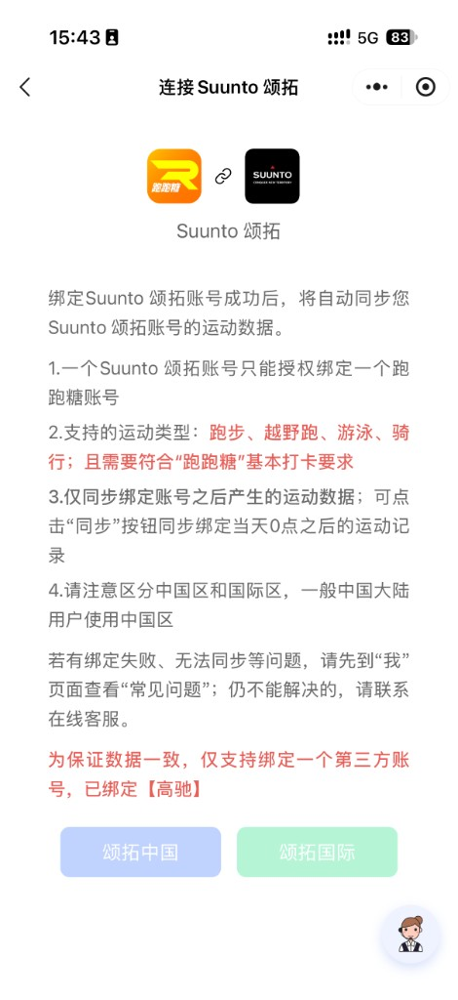

#### 收到跑团里之后怎么用

运动页放这个人自己的跑量。跑团页放本团的榜、动态和报表。团长在本团里改规则、分组和导出。H5 和小程序用同一套字段。

**运动页**

- 今年跑量、今年天数和次数、累计跑量、累计次数。
- 按月看：月跑量、天数和次数、用时、跑步平均配速、本月目标完成度。
- 记录按时间倒序。每条写类型、里程、跑量、配速、用时、爬升。来自跑表的可以展开心率、步频和热量。
- 手填一场：类型只有跑步或越野，再写开始时间、里程、用时、爬升。本团允许手填时可以加一张截图。配速由用时除以里程得出，不另填一个可能对不上的数。
- 设立本月目标。目标是公里数，不能低于他所属跑团里、对应性别的下限；几个团都有下限时，取最高的那个。账号现在不收集性别。成员没有填写性别时，下限取该团两项里较高的一个。性别由本人自己选择，不从身份证读取。
- 跑表区在接入之前标明「尚未接入」。手填在接入之前一直可用。

**跑团页**

- 团的头部写成员数、已计入本团的总跑量、总次数。
- 三块：排行榜、分组榜、今日动态。时间用今日、本周、本月、今年、累计。
- 今日从北京时间 0 点起。一周是周一到周日。累计从入团时刻起，入团前的记录不进这个团。
- 排行榜可以搜昵称。前三名标名次，其后用数字。每人写出跑量和跑量分组。
- 分组榜把该时段内、已计入的跑量按分组相加。没有分组的人归入「其他」。
- 今日动态列出已计入的记录。成员可以质疑，并写一句原因。团长或跑团管理把它标成不计入，或留下继续计入。不计入后，它退出这个团的榜、报表和总跑量，个人列表里还在。
- 周报、月报、年报的列与上表相同，可以换周、换月、换年。合计行只加次数和跑量，天数不进合计。平均配速只用来自类型「跑步」的记录，用这些记录的总用时除以总里程，不对单次配速做简单平均。时长去掉秒。

**谁可以改**

| 动作 | 谁 |
| --- | --- |
| 手填、删除自己的记录、设立自己的月度目标 | 本人 |
| 质疑一条动态 | 本团成员 |
| 把质疑标成不计入或继续计入 | 团长、跑团管理 |
| 改本团规则、跑量分组、导出 | 团长。跑团管理可以查看，不能改规则 |
| 看本团的榜、动态、报表 | 本团成员。团外的人打不开 |

删除自己的记录后，所有团里由它产生的计入一起去掉。

**一场怎样进入某个团**

一条记录先属于这个人。对他所在的每一个团分别判断，全部满足才计入该团：

1. 记录的开始时间不早于入团时间。
2. 这个类型在该团是打开的。
3. 里程落在该类型的最短和最长之间。跑步还要看配速，不快过最快、不慢过最慢。越野还要达到最低爬升。
4. 手填的记录，该团允许手填。只来自跑表的记录，来源是跑表。
5. 没有被标成不计入。

不满足的记录留在个人列表，该团的榜和报表里不出现。改规则只影响之后新记的场，已经计入的不重算。保存规则时写明这一点。

**默认规则**

新团沿用图里的数值，并按我们现在没有跑表接口做两处调整。

| 项 | 默认 |
| --- | --- |
| 允许手填 | 开。跑表接入之后，团长可以关掉 |
| 跑步 | 开。1 到 128 公里，配速 3:00 到 15:00 |
| 越野 | 关。打开后最短 5 公里，最低爬升 100 米 |
| 越野跑量累加爬升 | 关。打开后，新的越野记录按每 100 米爬升加 1 公里。这个比例图里没有，是本方案的取值 |
| 游泳、骑行、健身、球类 | 这一版不做 |
| 月度目标下限 | 女生 10 公里，男生 10 公里。个人目标可以更高。未填性别时，取两项里较高的一个 |
| 当月入团 | 自动观摩。这个月的目标完成度不标成未达标，榜上仍可以看到他的跑量 |
| 惩罚 | 不设。不扣款，不扣积分 |

公里榜只加跑步和越野的跑量。跑步的跑量等于里程。越野在爬升开关打开时，跑量 = 里程 + 爬升米数 / 100。其他运动这一版不记。

天数是有记录的自然日数，同一天多场仍是 1 天。次数是记录条数。一天里起止时间重叠的后一条不进入任何团，并提示已经有一场。

**跑量分组**

跑量分组是人在团里的长期分组，用来做分组榜。一个人在一个团里只有一个跑量分组。活动报名仍选那一场活动自己的组，两组互不占用。

**导出**

团长导出的是本团已计入的跑量。范围用周、月、年、入团后累计或自定义起止，并可以选择没有记录的成员是否出现。列与月报相同。文件在页面上下载。不绑定邮箱，不导出身份证和手机号。

**和现有账本分开**

团练签到仍只回答今天谁到了。活动的积分门槛仍用那场活动自己的里程，不改成去读跑量记录。礼品仍只用团内积分兑换。运动页已经放上手填的跑步和越野。跑表尚未接入，页面上没有绑定按钮。

**跑表以后怎么接**

接入顺序仍按第 8 节：先高驰，再佳明，再华为。接上之后沿用图里的绑定约束：一个跑表账号只绑一个平台账号，一个人同时只绑一个品牌；只拉绑定之后的数据；改密码要重绑；佳明和颂拓分中国区和国际区。没接上之前，运动页不显示一个可以点的绑定按钮，避免看起来已经能同步。

### 3.11 跑团活动报名：参照趣动

记于 2026-10-21，依据趣动小程序里「贰叁玖精英训练营」的活动界面。第三步已按这一节和 3.12 做了。

现在已经上线的活动是：标题、地点、开始时间、说明、这场积分规则、组别（名称、配速、人数上限）、报名、签到、相册。相册仅本团可见。这一节在这些字段上补一场日常团练还缺的结构。不收款，不收水费，不卖保险，不收集身份证。不做关注、粉丝、私信、Pick 和运动搭子。

#### 图里一场团练怎么报名

跑团主页把活动、成员、相册分成三栏，旁边有排行榜和活动日历。图上这个团有 148 场活动、509 名成员。日历按钮在图里，没有展开后的月历。


活动列表可以看全部、报名进行中、报名已结束、周期活动。一张卡片有封面、标题、开始时间、地点、右侧一个公里数、项目标签和接受的等级，以及名额。报名中的按钮写成「¥0 起报名」。已结束的一场写成 57（男 44、女 13）/177。图上两场进行中的活动，公里数是 27.1 和 27.4；同一批活动出现在分享层时，同一位置变成 0.1。两个数对不上，看不出是计划里程还是离手机多远。

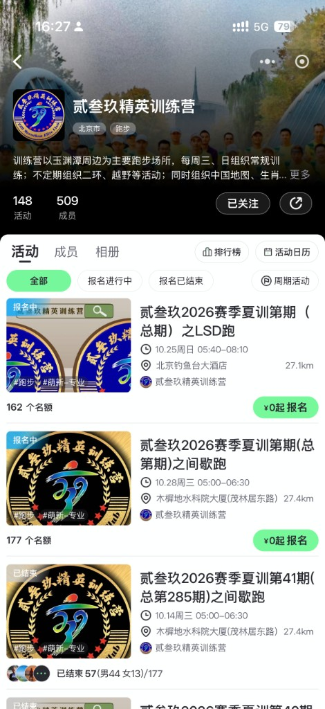

点进一场，封面下是期次标题。图上这场是「2026 赛季夏训第 41 期（总第 285 期）之间歇跑」。时间写成「10.14 周三 05:00–06:30」，地点是「木樨地水科院大厦（茂林居东路）」。费用显示「¥0 起」。等级写成「男 | 萌新–专业」「女 | 萌新–专业」，旁边有说明。标签里有一枚「保险」。

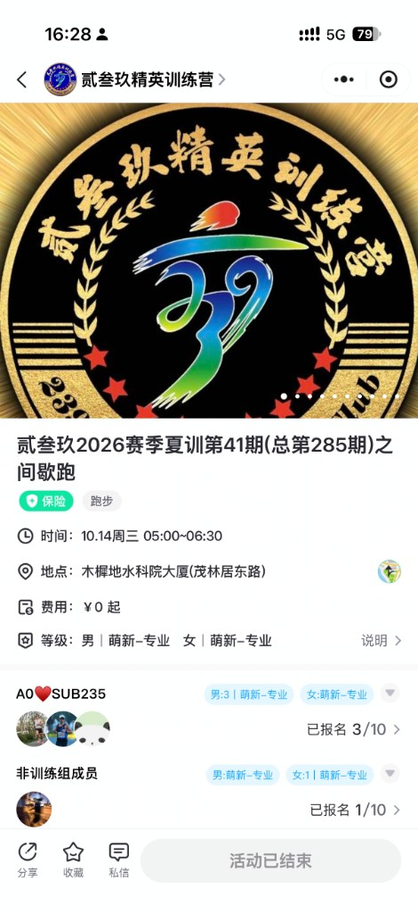

组别按配速目标命名，并带人数上限。图上能读到的是：

| 组 | 图上的名额 |
| --- | --- |
| A0，SUB235 | 3/10 |
| A1，SUB245 | 3/20 |
| B1，SUB300 | 7/25 |
| B2，SUB315 | 3/20 |
| B3，SUB330 | 9/20 |
| C1，SUB345 | 16/20 |
| C2，SUB400 | 4/20 |
| D 组，安全完赛 | 1/10 |
| 志愿者 | 1/2 |
| 非训练组成员 | 1/10 |

SUB 后面的数字和训练计划里的配速用的是同一套秒数。计划里「6km/410」是每公里 410 秒，也就是 6 分 50 秒。组名里的 SUB300、SUB400 则是马拉松目标：3 小时内、4 小时内。安全完赛、志愿者和非训练组不是配速组。每一组写出已报名的男女人数，以及这组接受的自评范围。图上这个范围都是从萌新到专业，也就是四档全开。

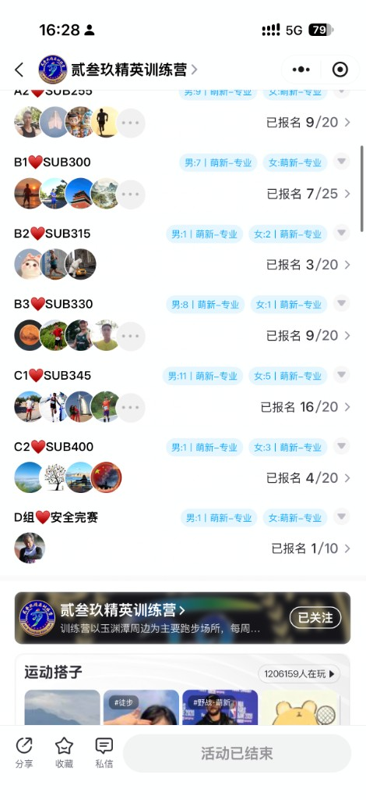

报名名单按组展开。每一行有名次、头像、昵称、「一起玩过 N 次」和自评。同一个人在名片上和名单上都是「一起玩过 8 次」。图里只有一个查看者，换一个人看会不会变，这批图没有第二例。

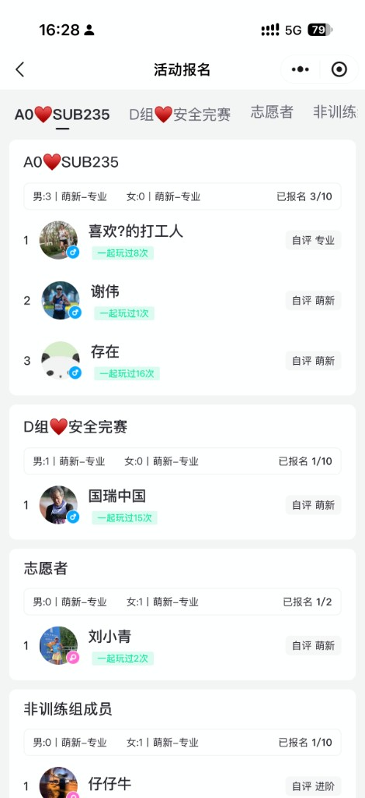

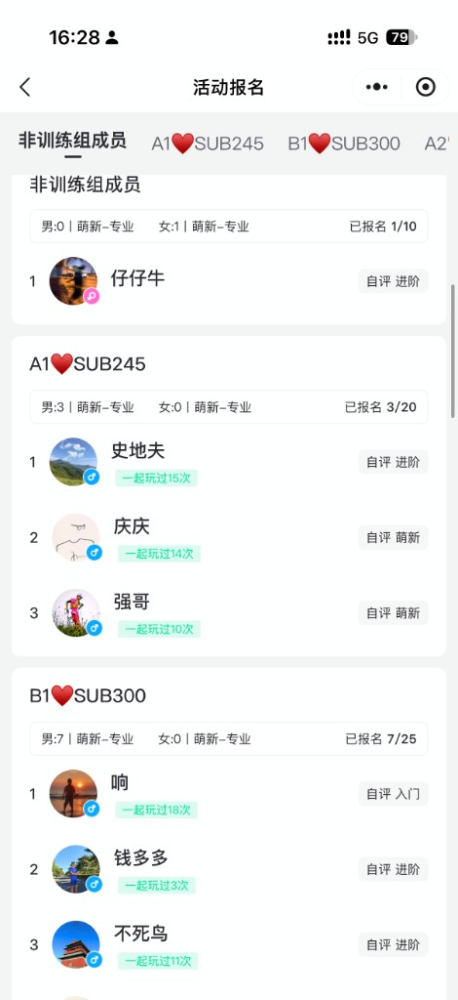

自评有四档，点「说明」看到定义。这是参与者自己选的，不是平台核定。

| 等级 | 图上的定义 |
| --- | --- |
| 1 萌新 | 没参加过，或参加少于 3 次，不了解规则，想体验 |
| 2 入门 | 参加过，了解规则，能跟着完成，以娱乐或拍照为主 |
| 3 进阶 | 参加过 10 场以上，熟悉规则和基本动作，想提高 |
| 4 专业 | 有多年经历，曾是省市、职业俱乐部或高校队成员，参加过市级以上专业赛事 |

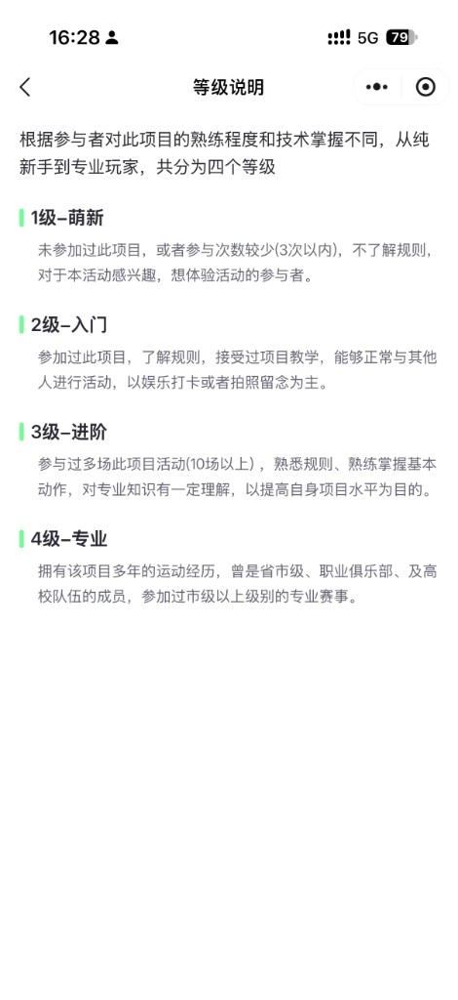

说明正文用小标题分段。这场写了训练类型（间歇跑）、集合时间、集合地点（木樨地地铁 E 口）、路线（水科院 1.5 公里小环线）、存衣、对连续跑 10 公里和配速的建议，然后是分组计划。A1、B1、C1 各写有氧、间歇和 800 米的距离与配速；A2 写「慢 10 秒」，B2 慢 15 秒，B3 慢 25 秒，C2 慢 20 秒，都是相对上一组的秒差，系统没有另算。地点栏的大厦地址和正文里的地铁口不是同一句，一场活动同时有集合点和路线名。正文里还可以插入路线图和往期照片。

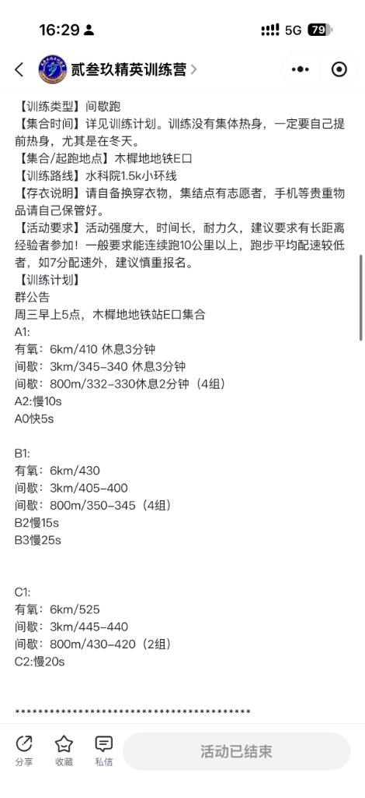

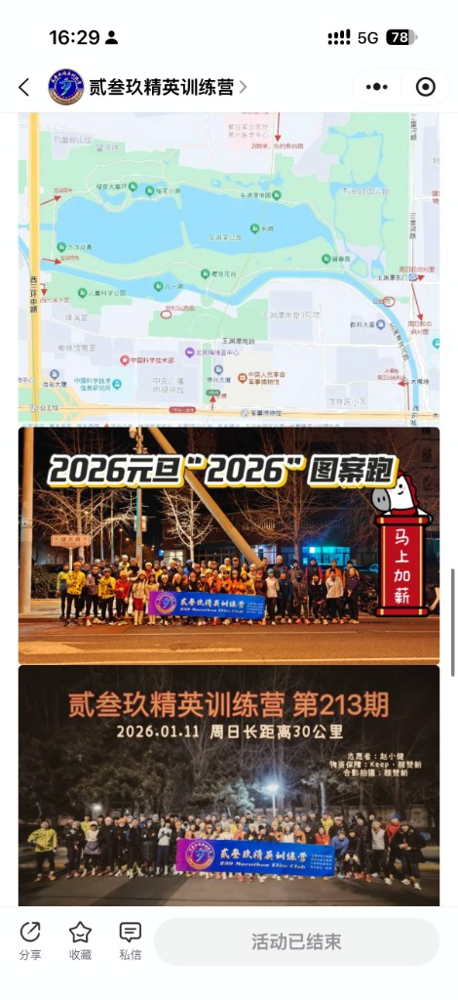

费用和安全也写在正文里。费用说明要求非训练组按次交水费，或一次交齐进入训练组，并写明水费不含保险、建议自行购买。安全说明是四条路上的站位和让车。另一段是八点注意事项，以及一段「参加即默认接受免责、组织方不承担任何法律责任」。页底在活动已结束时，分享、收藏、私信还在，报名不再打开。

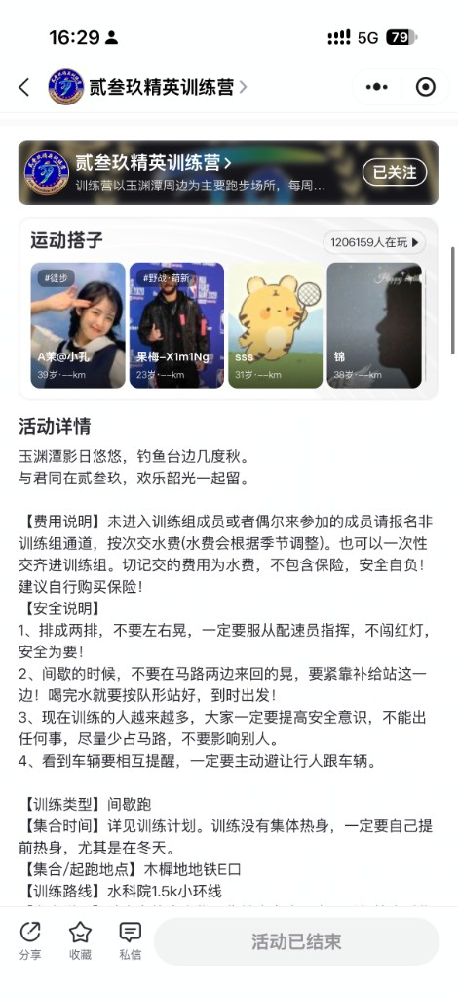

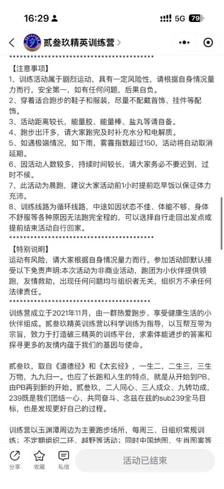

分享有两种入口。一种先勾选要分享的场，可全选、最近 3 场、最近 5 场、近 3 天、近 7 天，再选分享链接或分享图片。另一种从这场里打开：分享页面、生成海报、生成二维码、复制信息。

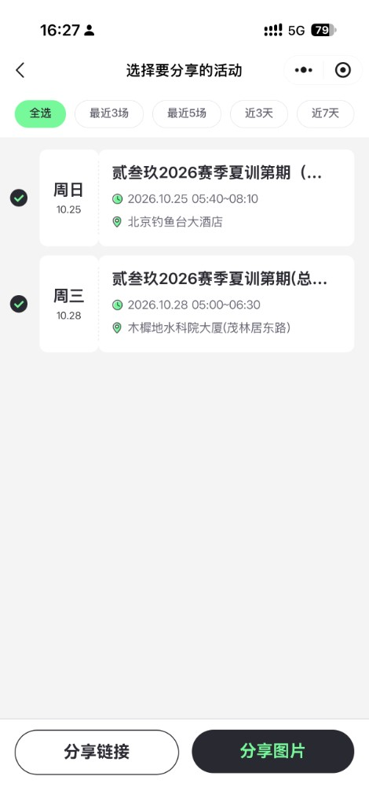

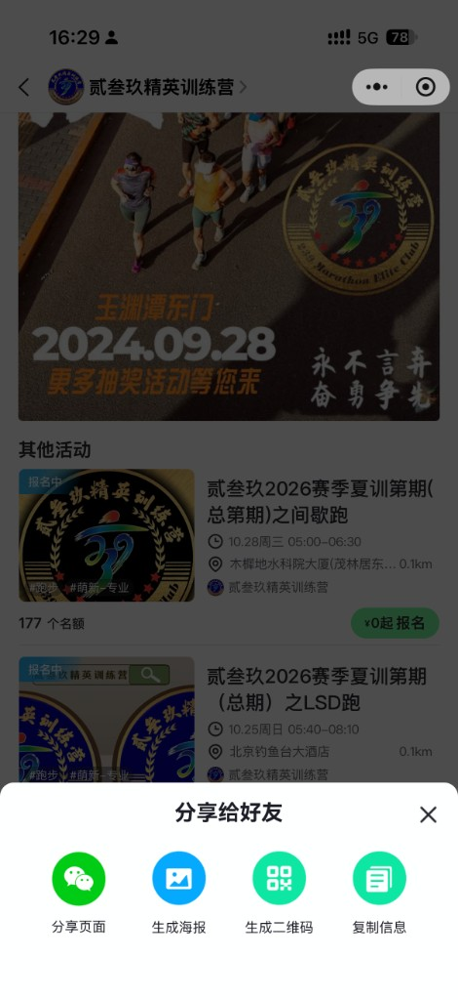

排行榜的第一项是出勤，单位是「次」。时间有日榜、总榜、周榜、月榜、季榜、年榜，月榜可以换到 2026 年 10 月。自己的一行钉在上面，图上是「未上榜、0 次」。前几名都是 3 次。旁边还有步数、跑步、徒步、骑行，这批图没有打开。底部是分享和「去冲榜」。

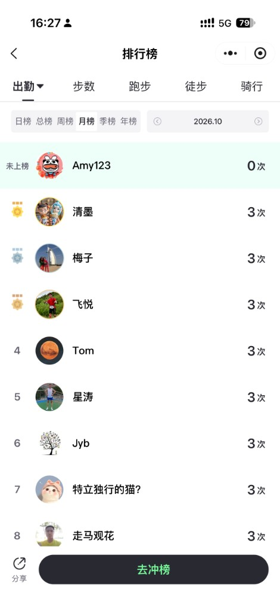

成员一栏是照片墙，角上有项目标签和 Pick。个人页有封面、趣动号、公里数、城区、性别、「一起玩过」、关注、粉丝和获赞。这些是社交关系，不是报名本身。


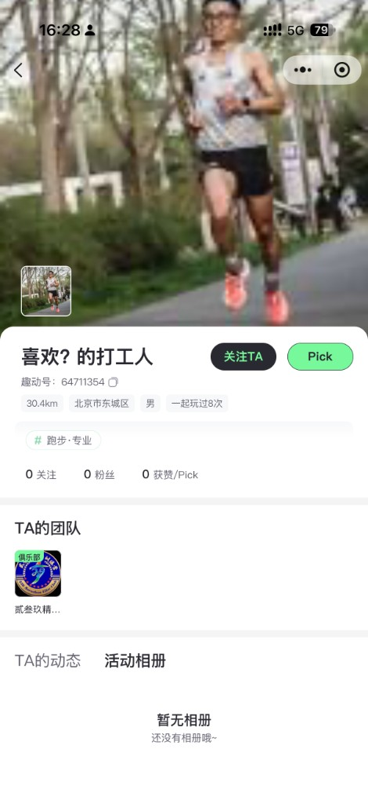

#### 收到现在的活动里

已上线的标题、地点、开始时间、说明、组别、报名、签到、相册和积分规则都留着。下面这些已补上。

**一场活动再加的字段**

| 字段 | 怎么填 |
| --- | --- |
| 结束时间 | 图上是 05:00–06:30。开始时间已有，补结束时间 |
| 期次 | 可空。写了就出现在标题下，例如「第 41 期，累计第 285 期」。不自动生成下一期 |
| 计划里程 | 团长填写的公里数，写在卡片上。不按手机定位计算 |
| 集合点 | 和地点分开。地点是图上的大厦，集合点是地铁口 |
| 路线 | 一段文字。路线图用团长放进说明或相册的图片，不另接地图 |

列表分三项：报名中、已结束、全部。开始时间未到且未满员是报名中；结束时间已过是已结束。图里的「周期活动」没有看到如何生成下一期，本方案不另做重复活动，每周一场仍逐场发布。

报名按钮写「报名」。不出现金额，不出现「¥0 起」。

**组别**

一组只属于这一场，和 3.10 的跑量分组分开。种类是配速组、完赛组、志愿者、非训练。配速组写目标，例如「马拉松 3 小时内」或「配速 6:50」；「慢 10 秒」由团长写在这一组的配速里，系统不算秒差。志愿者、完赛组、非训练组可以不写配速。每组有人数上限，0 表示不限。一个人一场只能报一个组，组满了不能再进。

名单写出昵称和这一场的自评。成员填了性别时，组头部分开男女人数；没填的只进总人数。性别沿用 3.10：本人自己选，不从身份证读取。

**自评**

报名时可选萌新、入门、进阶、专业，四档说明用上表的原文。不选也能报名。名单上写实际选择。等级不拦截报名，建议写在说明里。

「一起玩过 N 次」是当前查看者和这个人在本团共同签到过的活动场数。只在本团内算。没有共同场次就不显示这句。

**说明**

说明仍是一篇文字。团长用小标题写下训练类型、集合时间、集合点、路线、存衣、强度建议、各组计划和路上的注意事项。平台不代写「组织方不承担任何法律责任」，也不把免责做成报名时必须勾选的条款。团长若自己写进说明，按原文保存。

水费和保险不作为字段，也不做成标签或支付。需要提醒自备饮水或自行决定是否买保险时，写在注意事项里。

**谁可以做什么**

| 动作 | 谁 |
| --- | --- |
| 发活动、改活动、加组、结束这场 | 团长、跑团管理 |
| 报名、取消自己的报名、选自评 | 本团成员。已结束或已满的组不能再报 |
| 看名单、说明、相册 | 本团成员。团外打不开 |
| 签到 | 仍按现在的签到。签到不改成跑量，积分规则不变 |

**分享**

成员可以分享一场，或勾选最近 3 场、最近 5 场、近 3 天、近 7 天里的几场。分享出去的是标题、时间、地点、集合点和各组剩余名额，可以复制成文字，也可以生成只含这些字的图片。分享不加积分，不增加报名次数。年会海报、图案跑长图由团长放进说明或相册，不做成平台模板。

**出勤榜和日历**

出勤按本团已签到的活动次数。只报名、未签到不加。范围是今日、本周、本月、本季、今年、入团之后累计。季是自然季。自己的次数和名次钉在榜首；没有名次时写「未上榜」。步数、徒步、骑行不单开榜。跑步公里用 3.10 的跑量榜。

活动日历把本团活动标在开始日期上，点开那天列出这几场。图里只有入口，月历按这个规则补。

**这批图里不收的**

成员照片墙、Pick、关注、粉丝、获赞、私信、趣动号、运动搭子，都不做。成员仍是现在的名单。活动结束后来的人可以看说明和名单，不能再报名。报名页的最终样子以 3.12 为准。

### 3.12 报名页：趣动、闪动，以及我们的页面

记于 2026-10-21。这一节对比两个小程序的报名界面，并定我们自己的页面。第三步已按这一节做了。3.11 的字段仍然有效；两边对报名页说法不同的，以这一节为准。

#### 两个报名页各做什么

趣动把报名摊在活动详情里。选组、看名单、看计划是同一条向下的页面。一组一块，块上是男女人数和名额，块里是头像、昵称、一起玩过的次数和自评。分享时先勾选几场，再选链接或图片。详见 3.11。

闪动把「看名单」和「提交报名」分成两页。详情页先看已报名的人，报名页再填资料、选一个组、勾免责声明后提交。

俱乐部主页有出勤榜、活动记录、优惠规则、活动影集。活动按星期几排开，一张卡片有封面、标题、地点、公里数、时间和报名人数。有的写「免费活动」，有的写「¥0～8」。

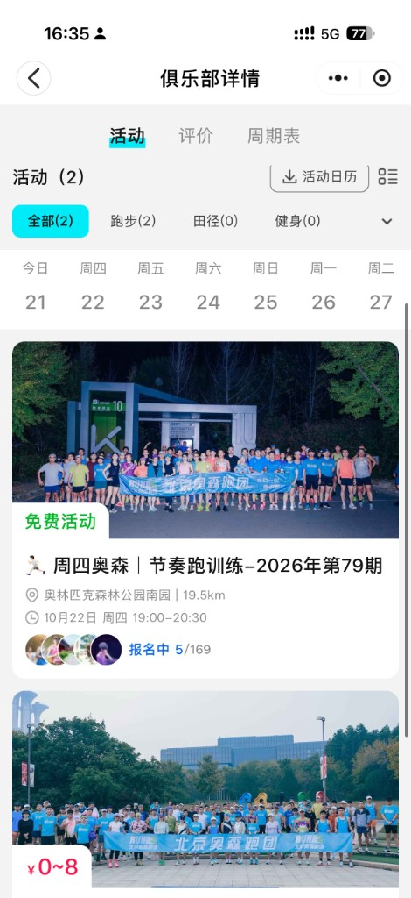

活动记录可以搜名称，并按未开始、活动中、已结束、已取消筛选。同一场长距离，未开始时是 7/408、¥0～8；取消后名单还在，写成活动取消、29/408。节奏跑写成免费。

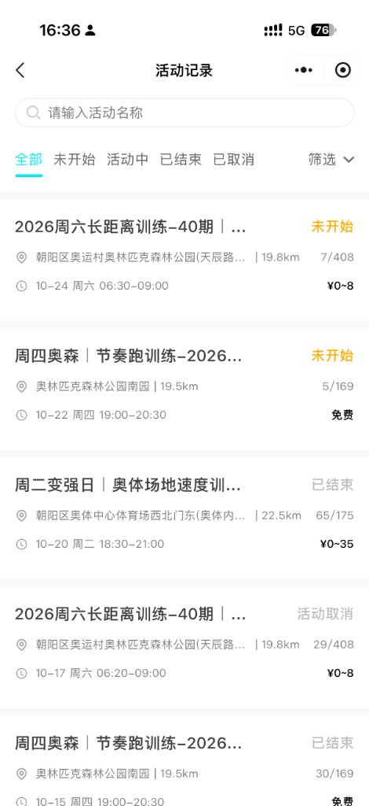

详情顶上是时间、男女等级范围和「等级说明」。已报名写成 65/175，并分开男女人数。每一组再写自己的人数，例如 A2 组 10/25。人名右边是自评：萌新、娱乐、进阶。娱乐和趣动的「入门」是同一档说明。等级说明里还有一层：俱乐部确认过的等级用蓝底加粗，例如 L6；其余是本人自评。这批名单上看到的是自评颜色，没有蓝底。

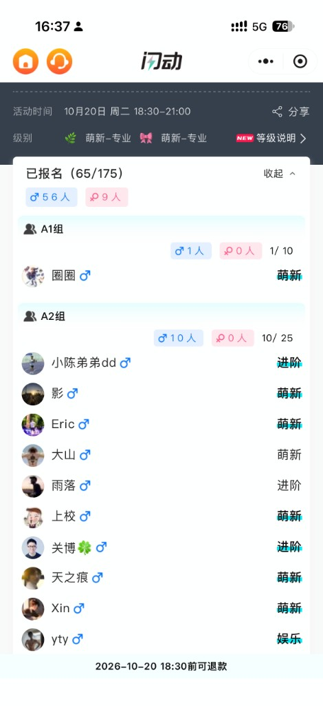

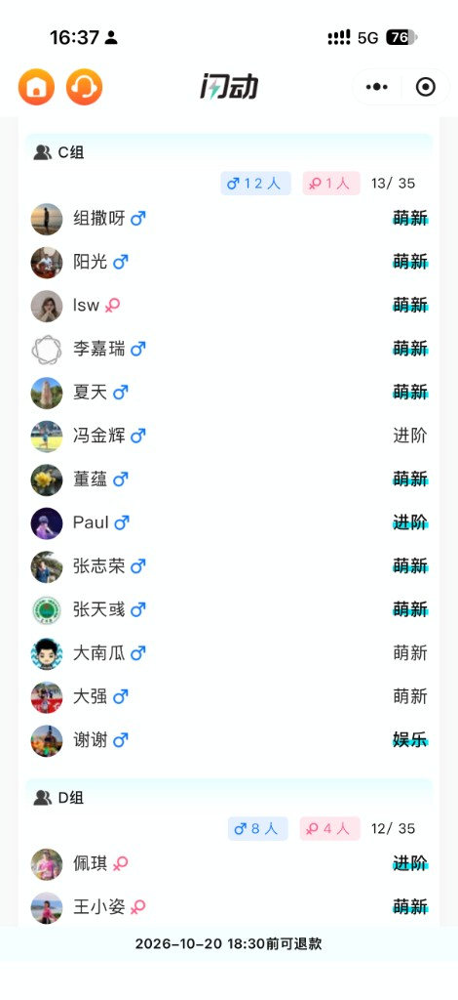

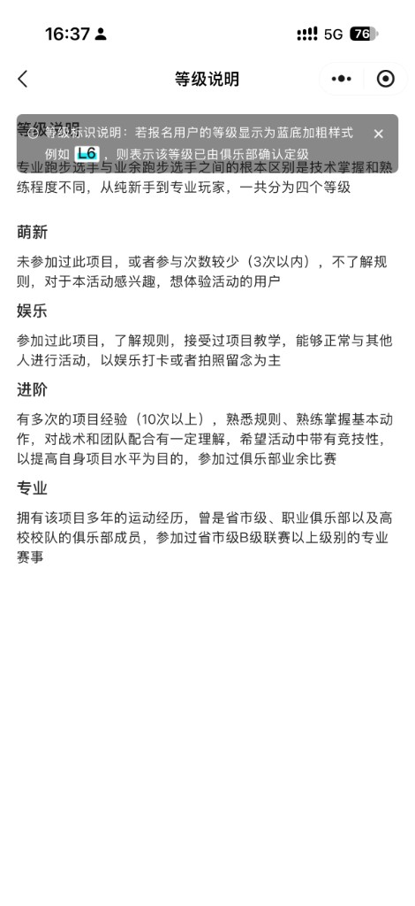

每组上面另有一条领跑员名额，写成「A1 组领跑员报名（Pacer）0/2」。领跑和普通组员分开报，名额更小，人名单列在组的前面。

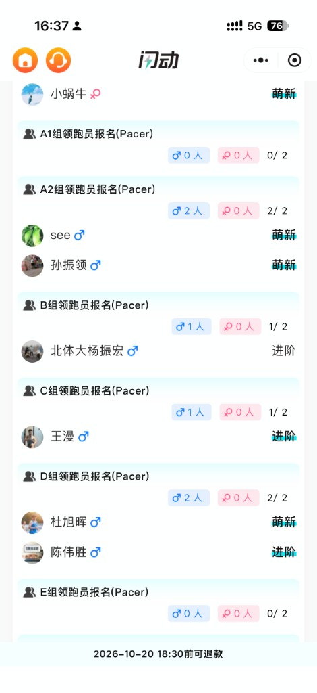

计划写在活动描述里，按组给配速。这场是倒金字塔：A1 热身配速 440–500，然后 5 公里、4 公里、3 公里、2 公里、1 公里逐段加快，每段休息，最后放松 2 公里。A2 到 E 组一段比一段慢。集合、开练、地点、补给、距离用括号标题写在正文前。路线用一张标了入口的地图，下面再贴一张东门照片。页底固定一句「2026-10-20 18:30 前可退款」，和集合签到的时间相同。

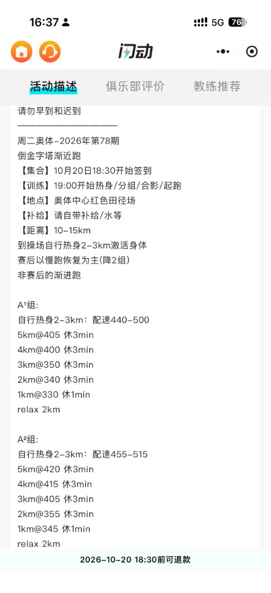

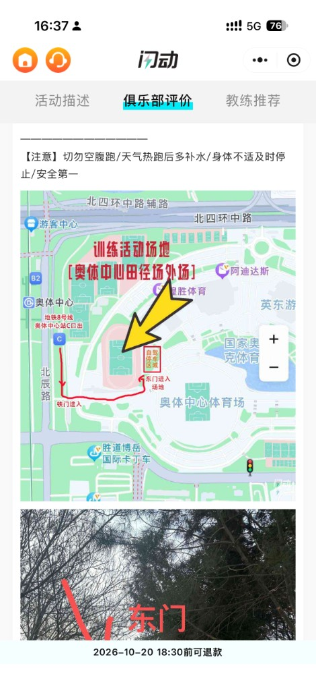

报名页先填报名信息：昵称、性别、手机号、级别。下面是「安全运动保障」，文案是一瓶水的钱换一份保险。再往下可以代好友报名，也可以打开匿名，匿名后不显示头像和昵称。然后才是选组。每一组一行，标着免费、男女等级范围、时间和已报名人数。提交前要勾选「我已仔细阅读并同意《免责声明》」。按钮旁是金额，图上还没选组，所以是「¥ --」。免责声明要求不适者不要参加，并写明代报名、未满 18 岁需监护人陪同、平台不担保。特别提醒写：活动若开了保险，须如实填姓名和证件号，否则买不了保险。

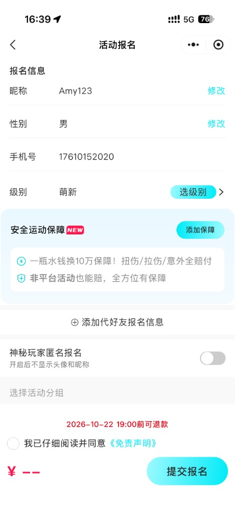

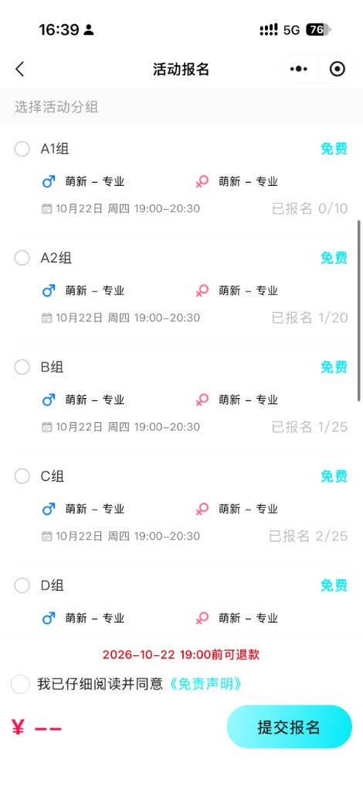

分享是另一页：全选、最近 3 个、最近 5 个、近 2 天、近 3 天，底部是文字分享和图片分享。趣动的对应按钮是近 3 天、近 7 天，以及分享链接、分享图片。

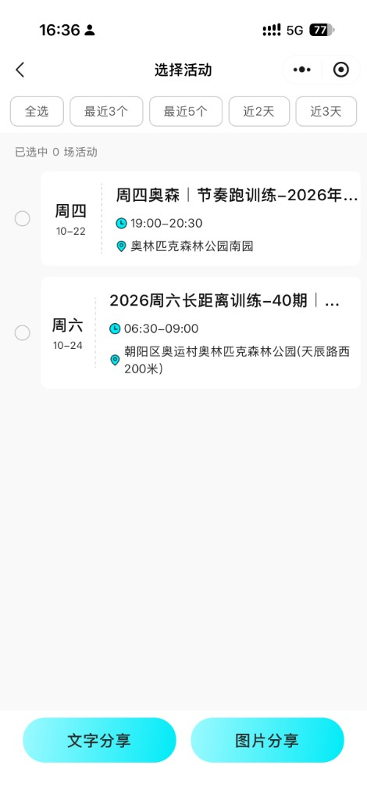

出勤榜前三名用奖牌，单位仍是次数，可切换本月和上月，并可导出长图。活动影集按以往的场列出封面和几张照片。


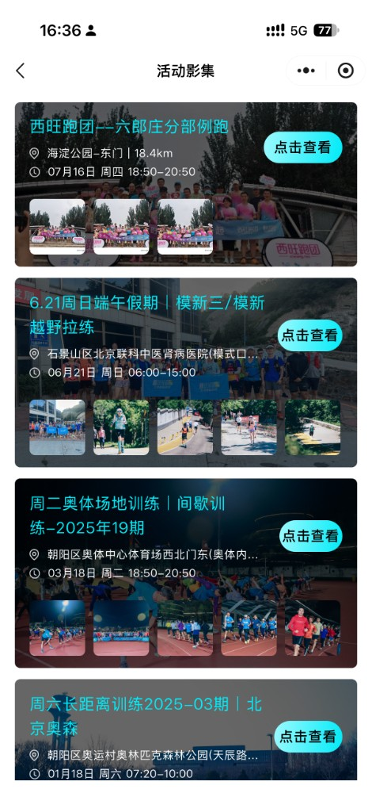

同一批图里还有俱乐部评分、优惠等级、余额、活动页广告，以及把报名费经平台转给组织者的说明。这些不进报名页。

#### 我们的报名页

页面只有四块：活动列表、活动详情、报名、分享。H5 和小程序用同一套。不出现金额、免费、保险、手机号、证件号、匿名、代报名和广告。

**活动列表**

放在跑团里。上面一行是从今天起的七天，点一天只看这天；另有「全部」。可以按标题搜。筛选项是报名中、进行中、已结束、已取消。

一张卡片从左到右是日期、标题、时间、地点、计划里程（团长没填就不显示）、已报名人数和上限。状态写在右侧：报名中、进行中、已结束、已取消。不写价格，也不写「免费」。

进行中是开始时间已到、结束时间未到。已取消是团长取消的，名单保留，不能再报名。

**活动详情**

从上到下：

1. 标题和期次。
2. 状态、开始到结束、集合时间、集合点、地点、计划里程。
3. 已报名人数。成员填了性别才分开男女，没填的只进总数。
4. 组别。一组一块：名称、配速或目标、人数。领跑写在组的最上面，最多 2 人，占用这组的名额。下面是已报名的昵称和自评。
5. 说明，含各组计划和团长贴的地图、门口照片。
6. 底部一条按钮。

按钮按状态变化：报名中写「报名」；已经报了写「取消报名」；进行中、已结束、已取消、所在组已满，按钮不可用，并写明原因。

**报名**

从详情的「报名」进入，一页完成。

| 区块 | 内容 |
| --- | --- |
| 昵称 | 只读，用当前登录的昵称。不在这里改，也不填手机号 |
| 性别 | 男、女、不填。不填则名单上不标男女 |
| 级别 | 萌新、入门、进阶、专业，可空。说明用 3.11 的四档原文。闪动把第二档写成「娱乐」，我们用「入门」。全部是自评，没有俱乐部盖章，也不做蓝底等级 |
| 组别 | 单选。一行是组名、配速、已报名人数。已满的组不能选。不写「免费」 |
| 截止 | 若团长把取消报名的时间设在开始之前，这里写「某时前可取消」。没有退款 |
| 提交 | 按钮写「提交报名」 |

一个人一场只能报一个组。提交后回到详情，自己的名字出现在所选组里。

领跑不在这一页另开一条报名。报名成功后，本人可以点「我来领跑」，或者团长、跑团管理把他标成领跑。这一组已经有 2 名领跑时不能再标。取消报名时，领跑一起去掉。

不设代好友报名，不设匿名。名单对团内可见，这是报名的目的。

不放免责勾选，不生成「平台不承担责任」的协议。详情说明里可以有团长写的注意事项。提交按钮下写一句：「请按自己的情况选择组别。」

取消报名在详情完成。默认可以取消到开始时间。团长可以把截止提前，例如改到集合签到的时刻。过了截止就不能自己取消。

**分享**

入口在活动列表。勾选一场或几场。快捷项用趣动的跨度：全选、最近 3 场、最近 5 场、近 3 天、近 7 天。闪动的近 2 天不单列，近 3 天已经盖住。底部两个按钮：文字分享、图片分享。文字是标题、时间、地点、集合点和各组剩余名额。图片只排这些字。分享不加积分。

**出勤榜和影集**

出勤榜仍按 3.11：已签到的次数，未签到的报名不加。前三名用名次，可看本月和上月。导出是一张榜的图片，不收集邮箱。

影集不另存一套照片。把已经上传到各场活动的照片按场列出来，点进那场的相册。相册页、审核和删除见 3.13。

**和 3.11 对齐的地方**

期次、计划里程、集合点、路线、分组种类、自评、积分和签到，仍按 3.11。这一节补上集合时间、领跑、取消报名截止，以及列表的进行中和已取消。报名页不再把免责、费用和保险留成可选项。

### 3.13 活动相册：参照喔图萌芽相册

记于 2026-10-21。这一节写每次活动的相册：团员自己传，团长和跑团管理也可以传，本团随时能看。第三步已按这一节做了。3.12 的影集按这一节做。

现在已经上线的相册在活动页底部。本团成员可以上传 jpg、png、webp 照片和 mp4、mov 视频。照片不超过 8MB，视频不超过 40MB，一场合计最多 30 个。只有本团能看。上传的人和团长可以删除。跑团管理还不能删别人传的。

#### 喔图的相册

喔图把相册做成单独的一份，不挂在某一次活动上。新建时选类型：家庭、班级、团建、聚会、婚礼、旅行、会议、其他。团建的说明是团队建设、集体活动。名称可以写成「10月21日创建的相册」。

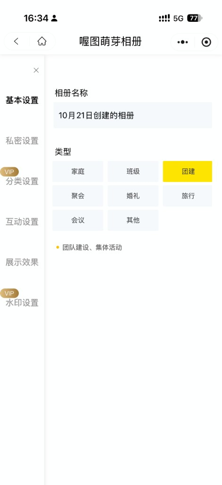

上传有三档：所有人可上传、输入密码可上传、仅本人上传。可以要求管理员审核后才显示，图上这个开关是关的。上传者默认可删除自己的照片。谁能看也有三档：所有人、输入密码、仅自己。

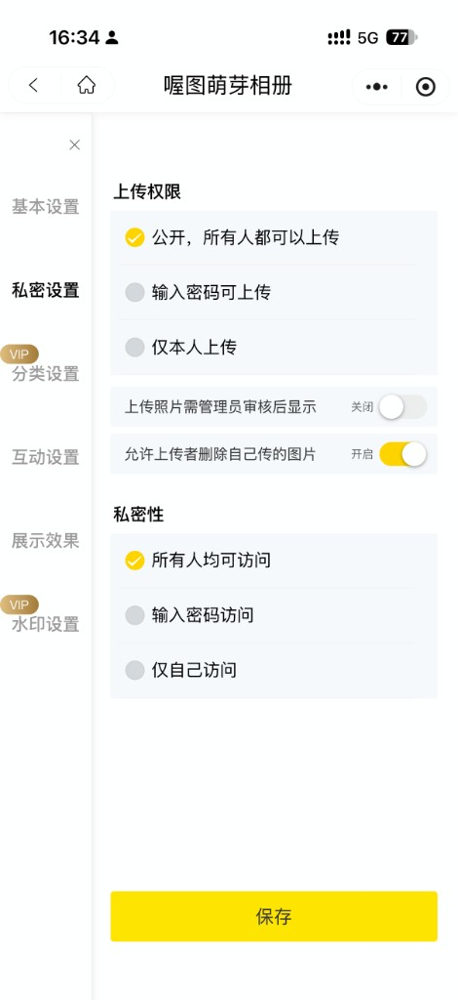

相册页顶上是名称，以及照片数、视频数、浏览量。一排工具：拼图、AI 找我、AI 合影、保存、放映、分享。下面分照片、视频、时间轴、热门。底部是管理、设置、风格和上传。没有照片时也是这个结构。

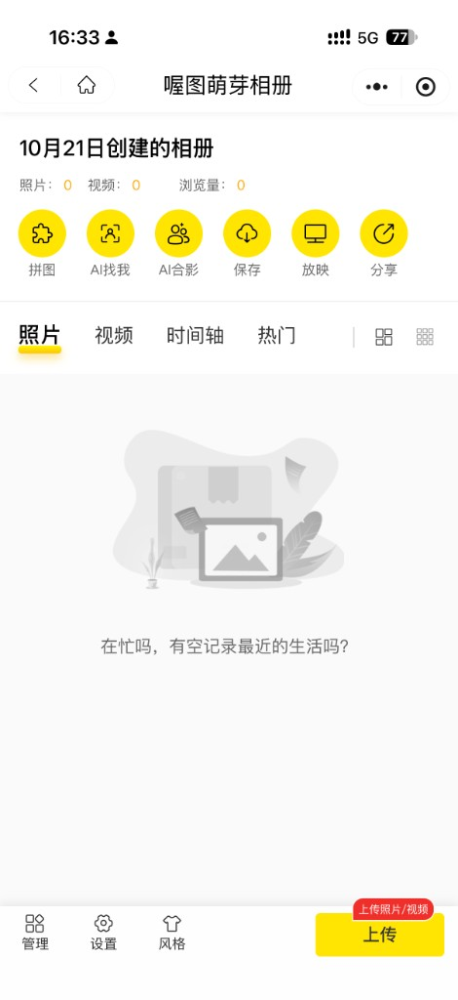

管理里分照片删除、照片审核、视频删除、视频审核、人员管理。另一屏还有大屏放映。


互动开关包括热门、点赞、美化、裁剪、拼图、AI 找我、AI 合影、保存、放映和分享。AI 找我标着 VIP，并要求先阅读人脸识别使用条款。保存可以下载到本地，或转到别的萌芽相册。设置里还有水印、风格和分类。风格有象牙白、高级黑、运动风、会议风、亲子风。水印可选左上、右上、居中等位置，同样标着 VIP。封面建议比例 3:2，顶部横图建议 5:2。


打开一场正在传照片的相册，页头是活动名、日期和话题。这场是李宁与北京奥森跑团的间歇训练，2026 年 10 月 20 日，地点奥体中心红色田径场，照片 357 张。版式可以在瀑布流、宫格、时间线之间换，顺序可以从早到晚或从晚到早。分享出一张海报：标题、日期、地点，中间是二维码，提示长按保存。


同一批图里还有微信授权昵称和头像、已购照片、云冲印、语言切换。那些不进这次设计。

#### 我们的相册

相册不单独创建。发一场活动，就有这场的相册。名称、日期、地点用活动自己的。H5 和小程序同一套。只对本团成员开放。

**谁上传，谁查看**

本团任何成员都可以传，不必先报名。团长和跑团管理用同一个「上传」，不另开入口。活动开始前、进行中、结束后都能传。团长取消活动后，相册还在，仍可看，仍可传。

已显示的照片和视频，本团成员随时能看。团外打不开。不设访问密码，也不做公开链接。

**跑团里的相册**

跑团页现在是比赛、活动、成员。相册加在活动和成员之间。这一栏只列出已经有照片或视频的活动，近的场次在前。一张卡片是封面、标题、日期、照片张数和视频个数。还没有内容的活动不出现。一栏是空的时候写「还没有活动照片。」点卡片进入那场相册。

**一场相册**

从上到下：

1. 标题、日期、地点。
2. 照片张数和视频个数。不统计浏览量。
3. 两个标签：照片、视频。排序默认从新到旧，可以改成从早到晚。版式默认宫格，可以改成瀑布流。
4. 格子是缩略图。视频格子写「视频」。点开后可以左右翻，并看到上传人的昵称和上传时间。
5. 底部按钮「上传照片或视频」。一次可以选多张。照片仍不超过 8MB，视频仍不超过 40MB。一场最多 400 张照片、20 个视频。参考这场喔图相册有 357 张，400 张够装下同样一场。超出的不上传，并写明还剩几张。

活动详情不再铺完整格子。那里留封面、张数和「查看相册」。

还没有照片时写「还没有照片。团员可以上传。」

**管理**

团长和跑团管理在相册页看到「管理」。成员没有这个入口。

| 事项 | 怎么做 |
| --- | --- |
| 删除 | 照片和视频分两格，可以多选后删除。团长和跑团管理可以删任何一张。上传的人在大图里删除自己的，这个始终保留 |
| 审核 | 一场一个开关，默认关闭。关闭时，传完就显示。打开后，新上传的先标「待审核」，别人看不到，上传的人自己能看到。团长或跑团管理通过后才进入相册。不通过就删除 |
| 封面 | 从已经显示的照片里选一张。没人选过时，用最早的一张已显示照片。跑团相册那一栏用这张 |

不另设相册管理员。能管相册的人就是团长和跑团管理。

**分享**

相册页可以生成一张图片：封面、标题、日期、地点、照片张数。图上写「本团成员打开跑团即可查看。」不放打开相册的二维码。分享不加积分。

**留下的边界**

拼图、美化、裁剪、点赞、热门、风格皮肤、水印、分类文件夹、大屏放映、云冲印和已购照片，都不做。不用人脸把照片分到某个人，也不做 AI 合影。不收集手机号。上传不加积分。

**和现在实现的差别**

原先是活动页底部一块，照片和视频合计 30 个，只有上传者和团长能删。第三步改成单独的相册页和跑团里的相册一栏，上限分成 400 张照片和 20 个视频，跑团管理可以删除任意一张，并加上可选的审核和封面。

### 3.14 会费：钱直接到跑团，平台只记名单

记于 2026-10-21。团里现在收会费要一个人对一个人对账。这一节只做名单和收款码。平台不收款，不代持，也不把钱分给任何人。和第 5 节以后可能做的「跑团会员包」不是一回事。第一步已按这一节做了。

**钱怎么走**

团长上传一张收款码图片。成员在微信里扫这张图，钱进这张码对应的账户。码用谁的，由团长决定，可以是团长自己的，也可以是负责收会费的跑团管理的。平台看不到转账，也不核对金额。页面上写明：「会费直接付给跑团。平台不经手，以团长确认为准。」

不收集银行卡号、手机号和身份证。不从收款码里识别账号。不开发票。团长若要说明收据怎么开，写在这一期的说明里。

**谁能改**

金额、起止日期、收款码和下面的报名限制，只有团长能改。团长和跑团管理都可以把某人标成已收到或未收到。移交团长后，收款码还在，新团长可以换掉。

**一期会费**

团长开一期，填写：

| 项 | 怎么填 |
| --- | --- |
| 名称 | 例如「2026 年度会费」，1 到 20 个字 |
| 金额 | 整数元，1 到 10000。只展示，平台不收这笔钱 |
| 开始、结束 | 结束日当天仍可登记 |
| 说明 | 可空，最多 200 字 |
| 收款码 | 一张 jpg、png 或 webp，不超过 8MB。只有本团能看 |
| 未交能否报名 | 默认关闭。打开后，未交和待确认的人不能报名日常活动，也不能报名队内赛。约跑、看相册、看成绩不受影响。免交的人可以报名 |

同一时间只有一期在收。再开一期时，上一期停止登记，名单留着。成员栏能翻以前的期次。

**成员看到的页面**

放在跑团的「成员」里，标题是当期名称。

1. 金额、起止、说明。
2. 收款码。长按可以保存。
3. 自己的状态：未交、待确认、已交、免交。
4. 未交时有按钮「我已转账」。点完变成待确认。
5. 全团名单。一行是昵称和状态。已交、免交、待确认、未交分四段，每段按昵称排。

没有收款码时，不显示「我已转账」，写「团长还没有放收款码」。

**管理**

团长和跑团管理在名单上把一个人标成「已收到」「未收到」或「免交」。已收到就是已交。未收到回到未交。现金交给团长的，不必等成员点「我已转账」，直接标已收到。

名单可以复制成文字，贴回微信群。两行：已交和免交写在一起，未交和待确认写在一起。不导出表格，不发到邮箱。

### 3.15 比赛成绩统计：发到群里填，填完全团能看

记于 2026-10-21。现在成绩多是私发给管理，再手工整理谁 PB、用时多少、是哪一场。赛事页其实已经能记成绩：写成 `45:30` 或 `3:29:59`，跑团的比赛一栏会列出团内成绩，同一个人同一距离用时更短就标 PB。缺的是团长发一次收集、成员从群里点进来填、没进赛历的比赛也能收。

这一节是那一次收集的页面。第一步已按这一节做了。不填身份证，不填手机号，不把成绩当成官方核验。

**发一次统计**

团长或跑团管理在跑团的「比赛」里点「成绩统计」，再点「发起」。

| 项 | 怎么填 |
| --- | --- |
| 比赛 | 从赛历里选一场，或者自己写名称。自己写的不新建赛历 |
| 日期 | 比赛日 |
| 距离 | 可多选：全马、半马、10 公里、5 公里。另有「其他」，填写 1 到 100 之间的公里数 |
| 截止 | 默认比赛日之后 7 天的 22:00。过了截止，成员不能再改 |
| 说明 | 可空，最多 100 字。例如「填净计时」 |

发起后得到一段文字，复制到微信群：

```
滨河跑团 · 2026 北京半程成绩
打开跑团的「成绩统计」填写，格式 1:32:10。
截止 10月28日 22:00。填完后全团都能看。
```

小程序同时可以转发一张卡片，点开就是这次填写页。不在这个跑团里的人打不开，看到「你不在这个跑团」。

**填写**

成员打开这一次统计，选自己跑的距离，填一个成绩。格式和赛事页相同：`45:30` 或 `3:29:59`，不超过 12 小时。可以附一张证书或截图，不超过 8MB。一个人一个距离一条。填错了，截止前可以改自己的。

能对上赛历的，这条同时写进他在赛事页的成绩。我的成绩、团内成绩都看得到，PB 仍按现在的规则：同一个人、同一距离，比已经记下的用时更短就是 PB。

赛历里没有的比赛，成绩只留在这次统计和本团的成绩册里，不写进个人生涯。以后赛历里出现了这场，由本人自己再记一次，系统不自动对上。

团长和跑团管理可以给某个成员补一条，用在本人不会操作的时候。补的那条标「管理员补录」。

**成绩榜**

全团能看。上面先是一句摘要，只列这次比自己同距离旧成绩更快的人，例如「这次 PB：小周 半马 1:32:10，队友 全马 3:28:00」。第一次记下这个距离的人写「首次」，不写 PB。没有人更快时写「这次没有新的 PB」。

摘要下面按距离分块，每块按用时从快到慢。一行是名次、昵称、成绩。PB 和首次标在成绩旁边。自己的那一行可以看出是自己。

比较 PB 时，赛历成绩和这个人以前在本团填过的同距离都算旧成绩。「其他」距离只和公里数相同的本团记录比，不和全马、半马混在一起。

截止后成员不能改。团长和跑团管理仍可改正或删除一条，也可以把截止延后。榜也可以复制成文字发回群里。

空的时候写「还没有人填写」。

### 3.16 约跑：三人以上，合影并打卡才记积分

记于 2026-10-21。私下约跑现在是群里发合影，再由专人点数给分。这一节把约跑收进跑团。第二步已按这一节做了。

约跑不是日常活动，也不是团练签到。团练签到仍然只记今天谁到了，不加积分，不记公里。约跑不加跑量。积分进现在的团内积分，可以换已经上线的礼品。

**一场约跑**

任何成员都可以发起。填写日期、地点、一句说明。地点最多 40 字，说明可空，最多 100 字。日期可以是今天或以后，不能是昨天。

发起后复制一段文字到群里，别人点开这场：

1. 「算我一个」。只是预报，不加分。
2. 当天打卡。打卡只表示人到了，不填公里。按北京时间，当天 0 点到 24 点可以打，过了当天成员不能再打。
3. 合影。参加者都可以传。至少 1 张，最多 9 张，jpg、png 或 webp，每张不超过 8MB。只有本团能看。合影留在这场约跑里，不进活动相册。

**怎么给分**

当天 24 点（北京时间）结算。两件都要有：至少一张合影，并且打卡不少于 3 人。人数按打过卡的人算，只点了「算我一个」的不算。

默认档位如下。团长可以改每一档的人数下限和积分。第一档不能低于 3 人。积分是 0 到 20 的整数，0 表示只留记录。

| 打卡人数 | 每人积分 |
| --- | --- |
| 3–4 人 | 1 |
| 5–7 人 | 2 |
| 8 人及以上 | 3 |

每个人按结算时的人数拿同一档，不按到场先后。同一个人同一天若参加了好几场，只给人数最多的那场记分。另外几场留着，积分写 0，原因写「当天已在另一场记过」。

缺合影或少于 3 人，这场积分为 0，状态分别写「缺合影」「人数不够」。

详情页在结算前写明当前会落在哪一档，例如「现在 5 人已打卡，有合影。今晚结算后每人 2 分」。

**补记和作废**

第二天发现没传照片，团长或跑团管理可以在 7 天内补上打卡或合影，并重算一次。重算会把原来的积分冲掉再按新人数重记。超过 7 天不能再改。

合影明显不符的，团长或跑团管理可以作废。已经发出的积分记一笔负数，原因写「约跑作废」。积分可以因此变成负数，负数不能换礼品。

**放在哪里**

日常活动的列表不动。约跑是活动栏里单独的一块，标题「约跑」。一行是日期、地点、打卡人数、状态。状态是进行中、已记分、人数不够、缺合影、已作废。

### 3.17 队内赛：和日常团练分开报名

记于 2026-10-21。队内赛是跑团自己组织的比赛，有报名截止和完赛名次。日常活动是每周训练，按配速组到场，人数和里程够了才给那场积分。两套名单不混在一个列表里。第二步已按这一节做了。

**和日常活动的差别**

| | 日常活动 | 队内赛 |
| --- | --- | --- |
| 谁能发 | 团长、跑团管理 | 团长、跑团管理 |
| 名单 | 配速组，用现在的组别 | 这场自己的组别，例如男子组、女子组、欢乐组。不改团里的配速组 |
| 报名 | 按 3.12，可一直报到开始 | 有报名截止，默认开赛时间。截止后不能再报，也不能自己取消 |
| 赛后 | 签到打卡，按人数和里程给分 | 填完赛用时，按组别排名。默认不给分 |
| 费用 | 没有 | 没有。要收钱走 3.14 的会费，不在报名页写金额 |

报名页比 3.12 更短：昵称只读，选一个组别，提交。不填手机号，不选等级，不选领跑，不勾协议。组别已满就不能选。会费开关若打开，未交和待确认的人不能提交。

**一场队内赛**

| 项 | 怎么填 |
| --- | --- |
| 名称 | 1 到 40 字 |
| 日期和时间 | 开赛时间 |
| 地点 | 最多 40 字 |
| 距离 | 全马、半马、10 公里、5 公里，或其他 1 到 100 公里 |
| 报名截止 | 不能晚于开赛时间 |
| 组别 | 至少一组。每组有名称和人数上限，上限 0 表示不限 |
| 说明 | 可空，最多 500 字 |
| 完赛积分 | 默认 0。若填 1 到 20，每个完赛的人得同样的分，不按名次加减 |

分享出去的文字是名称、时间、地点、各组剩余名额和报名截止。规则与 3.12 的分享相同，分享不加报名次数。

**成绩**

开赛之后，报了名的人填自己的完赛用时，格式仍是 `45:30` 或 `3:29:59`。也可以标「未完赛」。团长和跑团管理可以改正，也可以把没到的人标成「未出发」。

榜按组别分开，完赛的按用时从快到慢，未完赛和未出发排在下面。这个人若在本团以前的队内赛里跑过同一距离，并且这次更快，标「个人最好」。队内赛的用时不写进赛历成绩，也不和 3.15 的外面比赛混在一张榜上。

积分在这场标成已结束时入账，原因写队内赛名称。作废这场时，已发的完赛积分记负数。

队内赛放在活动栏的第三块，标题「队内赛」，排在约跑下面。状态是报名中、已截止、已结束、已取消。已取消的保留名单和成绩，不能再报名。

### 3.18 跑团功能的落地顺序

3.10 至 3.17 已开发。跑量只记跑步和越野，跑表未接。已经在用的入团、角色、日常活动、报名、签到、积分礼品、活动相册、赛历标记和赛事页成绩保持可用。每一步都加在这上面。

| 步 | 做什么 | 为什么在这一步 |
| --- | --- | --- |
| 第一步 | 会费名单（3.14）、成绩统计（3.15）。已做 | 这两件就是现在群里的手工账。成绩统计能对上赛历的，直接用已经上线的成绩，不用新做一套生涯。会费只记状态和收款码，不接支付 |
| 第二步 | 约跑（3.16）、队内赛（3.17）。已做 | 约跑把合影计分接上现有积分。队内赛单独报名、单独排名，避免和每周训练混在一起。会费若限制报名，这一步的队内赛一起生效 |
| 第三步 | 日常活动的字段（3.11）、报名页（3.12）、相册页（3.13）。已做 | 每周训练的页面补齐。相册单独一栏，照片和视频分开计数 |
| 第四步 | 跑量（3.10）。已做 | 先做手填的跑步和越野，以及团内规则。手表靠后，顺序仍是 COROS、佳明、华为。跑量不加积分，签到仍不记公里。游泳、骑行、健身、球类这一版不做 |
| 第五步 | 第 5 节的认证分级、物资池、分账和联赛。已做 | 不接支付，不收身份证。分账只记线下账。团里的会费不改成平台代收 |

第一步做完，团长可以在成员里看本期谁交了会费，也可以发一次成绩统计到群里，回来看到谁 PB、每条用时是哪一场。第二步做完，三人以上的合影打卡会自己记分，队内赛有自己的报名和名次。第五步做完，跑团这一侧按现在的范围就齐了：认证看人数和出勤，物资达标领取，分账只记线下账，联赛按月排名。会费仍不代收。赛历和生涯已经在用。拿奖雷达已做对照，不估算概率。

---

## 4. 成绩数据与验证码

> **结论：不破解验证码。** 中国马拉松官网的验证码是中国田协为保护大众成绩数据设的访问控制。自动识别、打码平台、模拟滑块轨迹，本质都是绕开它，不建议做，也不建议找人做。

### 为什么不做

| 风险 | 说明 |
| --- | --- |
| 法律 | 2025 年修订的《反不正当竞争法》（2025-10-15 施行）第十三条：不得以「避开或者破坏技术管理措施」等不正当方式获取、使用其他经营者合法持有的数据。情节严重还可能触及《刑法》第二百八十五条（非法获取计算机信息系统数据）。 |
| 个人信息 | 查询要姓名加完整身份证号。身份证号是《个人信息保护法》里的敏感个人信息，平台要单独同意、加密存储，泄露责任很重。 |
| 业务 | 数据源方是行业主管协会。被封 IP 或收到函，核心功能一夜归零，也会断掉以后和中国田协、数字心动合作的可能。 |
| 覆盖 | 官网只收 A、B 类和部分 C 类赛事成绩，C 类从 2025-03-22 起才入库。抓全了也不完整，还是得有别的导入方式。 |

### 可行的成绩获取方式

| 方式 | 用户怎么做 | 可信度 | 阶段 |
| --- | --- | --- | --- |
| 证书 / 截图导入 | 自己在中国马拉松官网、数字心动或赛事公众号查到后，下载证书或截图上传；OCR 识别赛事名、日期、项目、枪声与净计时成绩、号码布，匹配赛事库后确认 | 中：可与往届成绩公示交叉核对 | 第一版 |
| 手动录入 | 选赛事、填成绩。同一场的不同项目分开留下，也可以只去掉其中一项。可附证书或奖牌照片，标为「未核验」。识别位置留着，尚未开通，照片上的字仍由自己填写 | 低 | 第一版 |
| 跑表比赛日识别 | 授权连接 COROS、佳明、华为；比赛当天、起点附近、距离接近项目距离的运动自动生成「疑似参赛」，用户确认，官方成绩出来后用证书覆盖 | 中高 | 第二版 |
| 跑团批量导入 | 团员事先授权，赛后团长按名单对照官方公示录入 | 中 | 第二版 |
| 赛事方 / 计时公司合作 | 合作赛事按「姓名 + 号码布」回传成绩，不需要身份证号 | 高 | 第二、三版 |
| 与数字心动 / 中国田协合作 | 用户在官方侧授权，把认证赛事成绩分享过来 | 最高 | 有用户规模后谈 |

不推荐：让用户把官网查询结果页的链接贴进来，由服务器去拉数据。那个链接里带着完整身份证号，服务器自动请求同样属于绕开访问控制。

### 跑表接口门槛

| 平台 | 接口 | 门槛 |
| --- | --- | --- |
| COROS | Partner API：OAuth 2.0、Webhook、双向同步、GPX 路线 | 提交申请并发邮件到 api@coros.com，要求有一定用户基础 |
| 佳明 | Garmin Connect Developer Program：活动、健康、训练、路线 | 仅限企业；约 2 个工作日审核，接入 1–4 周；部分指标商用收费 |
| 华为运动健康 | Health Service Kit 云侧接口，小程序按服务器应用接入 | 企业实缴注册资本不低于 50 万元、成立满 1 年；高阶数据 500 万元；人工审核约 10 个工作日 |

### 身份证号怎么处理

- 默认不收集身份证号。
- 年龄组只需要出生年月，本地籍奖只需要户籍省份。
- 站内报名的实名信息直接交给赛事系统；确需留存时只存加密值和后四位。
- 团内展示谁报了哪场，默认只对团内可见，用户可以隐藏。

---

## 5. 跑团合作与激励

### 三方各得什么

| 角色 | 得到什么 |
| --- | --- |
| 跑团 | 物资（能量胶、团服、跑鞋试穿）、团练工具、活动经费、团长分佣 |
| 品牌 | 精准触达活跃跑者、真实穿着与测评内容、可核验的数据报告（参与人数、出勤、跑量） |
| 平台 | 撮合服务费、商城和酒店分佣、跑团带来的拉新和留存 |

### 激励与赞助方案

| 方案 | 怎么运作 | 钱怎么走 | 风险 | 建议 |
| --- | --- | --- | --- | --- |
| 品牌物资池 + 达标领取 | 品牌投放物资；认证跑团按等级拿额度；团员完成条件（如本月团练 4 次或月跑量 100 公里）领取 | 品牌付平台服务费，用户不付钱 | 低 | 第一版首选，能量胶和补给类品牌最好谈 |
| 装备打卡返还（替代押金） | 用户按售价买装备；每完成一次有效团练，对原订单发起一笔部分退款；满次数相当于免费 | 原路部分退款，平台不沉淀用户资金；没返完的部分是正常销售收入 | 中：规则须事先公示、不得中途改；没返的钱绝不能分给别人 | 第二版 |
| 微信支付分免押借用 | 支付分达标免押借走装备；完成 N 次团练转为赠送；未完成归还或按约定扣款 | 不收押金，由支付分做信用担保 | 中：要单独申请支付分和场景 | 第三版 |
| 跑团会员包 | 团员付年费，含团服、补给月包、团练服务；出勤达标返券 | 用微信支付分账给跑团 | 中：平台代收再转账属于二清 | 第二版。团自己收的会费不是这一种，见 3.14 |
| 跑团分佣 | 团员从跑团入口买装备、订酒店、报名合作赛事，团长得佣金 | 从平台佣金里分出 | 低：注意个税和分账 | 第二版 |
| 跑团联赛冠名 | 每月办跑团联赛（跑量、出勤、完赛率），品牌冠名，免费参与，奖品为物资 | 品牌付冠名费 | 低 | 第二版 |
| 赛道加油站 | 跑团在热门赛事沿途设加油站，品牌出物资和物料 | 品牌出物资 | 低：需赛事组委会许可 | 第三版 |
| 训练营 / 配速员 | 团内高手开收费训练营，品牌赞助装备 | 平台抽成 | 低 | 第三版 |
| 直接收押金 | 交押金，参加够次数退 | 资金沉淀在平台 | 高 | 不建议 |

### 为什么不建议直接收押金

- 押金沉淀要专户存管。可参照的监管口径是《交通运输新业态用户资金管理办法》：运营企业原则上不收押金，确需收取要开专用存款账户由银行存管。
- 「交押金、做不到被扣、扣的钱分给做到的人」就是当年的「早起打卡挑战金」模式。微信在 2018 年 1 月到 2019 年 7 月间处罚了 253 个这类小程序，重庆警方也破获过相关诈骗案。规则再透明也很容易被判违规。
- 打卡返还和支付分免押能达到同样的激励效果，又不碰用户资金。

### 打卡返还举例（示意数字）

一双 600 元的跑鞋，规定 12 次有效团练，每次返 50 元，每次返还是对原订单的一笔部分退款。微信支付限制支付后 365 天内可退、每笔订单最多 50 次部分退款，周期和次数要在这个范围里设计。「有效团练」用团长签到加跑表数据双重核验，防止代签。

### 跑团认证分级（建议值，可调）

| 等级 | 门槛 | 权益 |
| --- | --- | --- |
| 基础 | 团长实名，成员不少于 10 人 | 团内赛历、团练签到、榜单 |
| 认证 | 成员不少于 30 人，近 4 周至少 4 次团练 | 品牌物资池额度、跑团分佣 |
| 核心 | 成员不少于 100 人，持续活跃 3 个月，有集体参赛记录 | 优先参与名额活动、冠名联赛、团服补贴 |

参照：悦跑圈要求团长提供身份证审核、一号一团；咕咚线下活动只对认证跑团开放。

### 这一版怎么落地

第五步已做。不接微信支付，不代收会费，不收身份证。打卡返还、支付分免押、会员包、赛道加油站和训练营这一版不做。名额活动仍在第 6 节。

等级按现有数据现算，不另存。基础是成员不少于 10 人。认证是成员不少于 30 人，且近 28 天至少有 4 天有人签到。核心是成员不少于 100 人，含本月在内的近三个月每月都有人签到，并且至少有一场比赛有两名现成员标了状态或记了成绩。够哪一档就是哪一档，取最高的一档。人数不够 10 显示未达标。签到、赛历、跑量和积分不因等级关掉。

物资由管理员投放。认证跑团按额度领，核心跑团额度乘二。团员要达到这场写的那个月的签到天数和计入跑量，两项都要够，写成 0 的那项不卡。每人每场领一次。团长或跑团管理标成已发放。用户不付钱。

分账只记一笔线下账：服务费、分佣或冠名，金额是整数元，状态是未结或已结。平台不付款，也不进积分。团长和跑团管理能看金额，成员看不到。会费仍按 3.14，跑团自己收。

联赛一个月一场，管理员开，写冠名和奖品文字。团长免费参加，当月结束前可以退出。榜按计入跑量、签到人次、完赛人数排。核心跑团在榜上标优先，名次不因此提前。奖品是文字，不发现金。

---

## 6. 名额活动

### 热门赛事中签率

| 赛事 | 报名人数 | 名额 / 规模 | 中签率 |
| --- | --- | --- | --- |
| 2025 上马 | 31.7 万 | 2.3 万（全马） | 7.2% |
| 2026 上马 | 38.19 万 | 3 万 | 6% |
| 2026 北马 | 26.5 万 | 3.2 万（总规模） | 约 12%（估算） |

> **名额只能实名、不可转让。** 中国田协 2025-10-31 通知要求大众名额原则上不低于总规模 90%，严打倒卖；赞助商渠道名额要审核资格、管控用途，禁止转售。替跑、转让号码布可禁赛 1–5 年甚至终身。平台不能买卖名额，只能决定「谁拿到资格」。

### 名额活动的合规做法

| 环节 | 做法 |
| --- | --- |
| 名额来源 | 赛事赞助商的渠道名额（合作品牌本身是该赛事赞助商）、赛事方给平台的合作推广名额、公益名额（按《慈善法》公开） |
| 获得方式 | 免费参与：月跑量挑战、跑团贡献、赛记征集评选，或在达标者中抽签 |
| 抽签公平 | 规则提前公示；开奖前公布随机种子的哈希，开奖用公开数据（如指定日期的彩票开奖号）生成结果，任何人可复核 |
| 领取 | 中签人以本人实名走赞助商或官方通道报名，报名费按赛事规定自付或由品牌承担 |
| 禁止 | 付费抽名额；分享得抽签次数（诱导分享）；内定；活动开始后改规则 |
| 与购买挂钩时 | 属于有奖销售：最高奖不超过 5 万元，奖项和兑奖条件写清楚（《反不正当竞争法》第十一条） |

### 不需要任何合作就能做的中签辅助

- 每场赛事显示历年报名人数和中签率。
- 报名开启、截止、出签、缴费截止、二次抽签提醒（例如 2026 北马中签后须在 10 月 1 日 22 时前缴费）。
- 中签海报一键生成。
- 团内汇总中签名单；没中的团友提示二次抽签或同期替代赛事。

这一版的历年中签由管理员按公布数字录入，来源必填。页面用报名人数和名额算出比例，没有录入就不显示，也不写估算。中签后的卡片可以复制，也可以保存成图片。卡片上不写中签率。

---

## 7. 合规清单

| 事项 | 要求 | 影响板块 | 建议 | 级别 |
| --- | --- | --- | --- | --- |
| 主体 | 企业主体；个人主体用不了 web-view、直播等能力 | 全部 | 先注册公司 | 前置 |
| 备案 | ICP 备案和小程序备案 | 全部 | 上线前完成 | 前置 |
| 体育赛事类目 | 「体育-体育赛事」需政府主体，或政府部门资质授权文件、主办方授权协议；微信客服答复仅提供报名信息可能不需要该类目 | 站内报名 | 第一版只做资讯和跳转，签约赛事后再申请 | 做到时处理 |
| 社区类目 | UGC 发布交流需「社交-社区论坛」，并做内容安全 | 社交 | 第一版只做跑团内动态 | 做到时处理 |
| 直播 | 「社交-直播」需《信息网络传播视听节目许可证》或网络视听平台备案；直播组件还要求近 90 天有支付行为 | 直播 | 只做直播信息聚合 | 做到时处理 |
| 电商 | 自营要对应电商类目和资质 | 商城 | 先走联盟分佣 | 做到时处理 |
| 支付与分账 | 需微信支付商户号；平台代收后再转给跑团或用户属于二清 | 会员包、分佣 | 团内会费不代收，见 3.14。会员包和分佣再用微信支付分账 | 做到时处理 |
| 押金 | 原则上不收，确需收取要专户存管 | 激励 | 用打卡返还、支付分免押替代 | 高风险 |
| 抽奖 | 信息明确、不得中途变更、不得内定、最高奖不超过 5 万元 | 名额活动、物资抽取 | 规则公示，随机结果可复核 | 做到时处理 |
| 名额 | 不得转售倒卖，实名参赛 | 名额活动 | 只做资格评选 | 高风险 |
| 个人信息 | 身份证号、运动轨迹与健康数据、精确位置、人脸属敏感个人信息，需单独同意、最小必要 | 生涯、跑团、报名 | 默认不收身份证号，团内可见性可关闭 | 做到时处理 |
| 数据获取 | 不得避开或破坏技术管理措施获取他人数据 | 赛事库、成绩 | 只取公开事实并标来源，成绩走用户导入与合作 | 高风险 |
| 广告用语 | 不用「最」「第一」「保证获奖」 | 拿奖雷达、营销 | 文案上线前过审核清单 | 常规 |
| 诱导分享 | 不得用奖励诱导分享 | 名额活动、海报 | 分享只给内容，不给次数和奖励 | 常规 |

类目和资质以微信公众平台当期说明为准。

---

## 8. 技术架构

### 技术选型

| 层 | 建议 | 说明 |
| --- | --- | --- |
| 前端 | 微信原生小程序起步；若要同时出 App，再考虑 uni-app 或 Taro | 拉起官方小程序、订阅消息、视频号、微信支付都在微信内完成 |
| 后端 | Node.js（NestJS）或 Go，REST API 加管理后台 | 后台用于赛事库运营、规程复核、跑团审核 |
| 数据库 | PostgreSQL + Redis | 赛事、往届阈值、生涯记录是结构化关系数据；Redis 做提醒队列和排行 |
| 文件 | 腾讯云 COS + CDN | 证书、照片、视频 |
| OCR | 腾讯云通用印刷体识别 + 按赛事积累的证书模板 | 模板越多，识别准确率越高 |
| 规程抽取 | 大模型读竞赛规程 PDF，输出结构化奖项和时间节点，人工复核后发布 | 每个字段记录来源段落，方便复核 |
| 地图 | ECharts 中国地图做生涯点亮，腾讯位置服务做赛事地点 | |
| 跑表 | 按接入门槛先 COROS，再佳明，最后华为 | 华为对企业实缴资本有要求 |
| 定时任务 | 报名节点提醒、赛历更新巡检 | 订阅消息需用户先授权 |
| 内容安全 | 微信内容安全接口 + 人工抽检 | |

### 核心数据实体

| 实体 | 关键字段 |
| --- | --- |
| 赛事 Race | 名称、城市、认证等级、官网、官方报名入口 |
| 届次 Edition | 年份、日期、规模、报名方式、报名起止、缴费截止、直播 |
| 项目 Event | 所属届次、距离、关门时间、费用、资格 |
| 奖项 PrizeRule | 项目、类型（名次 / 年龄组 / 本地籍 / 破时 / 跑团）、名次、金额、税率、能否叠加、来源。往届名次成绩另写来源。已建表。没有往届成绩时不估算概率 |
| 往届阈值 Threshold | 项目、年份、性别、组别、名次、成绩 |
| 参赛计划 Entry | 用户、项目、状态、可见性、来源（手动 / 跳转回填 / 站内报名） |
| 成绩 Result | 用户、项目、枪声成绩、净计时成绩、号码布、核验等级（官方 / 证书 / 跑表 / 手填）、证书文件 |
| 跑团 Club | 目标模型：名称、城市、等级、团长。现在上线的是名称、口令、团长，成员角色为团长 / 跑团管理 / 成员，见 3.9 |
| 团练 Session、签到 Checkin | 时间地点、签到方式、跑表核验结果 |
| 赞助活动 Campaign、领取 Claim | 品牌、物资、领取条件、额度、待发放或已发放。见第 5 节。已建表。用户不付钱 |
| 跑团等级 | 按人数、近四周团练、近三个月出勤、集体参赛现算。基础、认证、核心。不收身份证。见第 5 节 |
| 分账记录 | 跑团、月份、服务费或分佣或冠名、整数元、未结或已结。线下账，平台不付款。见第 5 节 |
| 跑团联赛 | 月份、名称、冠名、奖品文字、参加的跑团。按跑量、出勤、完赛排。见第 5 节。已建表 |
| 跑团动态 | 正文、评论、点赞。只有本团能看。不加积分。见 3.7。已建表 |
| 历年中签 | 届次、报名人数、名额、来源。比例由这两个数算出。没有录入就不显示。见第 6 节。已建表 |
| 跑步记录 Run | 用户、开始时间、类型（跑步或越野）、里程、跑量、用时、爬升、配速、来源、截图。见 3.10。已建表，先手填 |
| 跑团跑量规则、跑量分组、计入结果 | 跑步和越野的开关和区间、月度目标下限、成员的长期分组、一条记录在每个团里算不算。见 3.10。已建表 |
| 活动补充字段 | 结束时间、计划里程、期次、集合时间、分组种类、报名自评、领跑、取消报名截止。见 3.11 和 3.12。已开发 |
| 活动相册 | 按场浏览、封面、审核开关。见 3.13。已开发。一场最多 400 张照片、20 个视频 |
| 会费期次 | 名称、金额、起止、收款码、是否限制报名。见 3.14。平台不入账 |
| 会费记录 | 成员、期次、未交 / 待确认 / 已交 / 免交。见 3.14 |
| 成绩统计 | 一场收集、距离、截止、每人一条用时。能对上赛历的写入现有成绩。见 3.15 |
| 约跑 | 日期、地点、加入、打卡、合影、按人数记入现有积分。见 3.16 |
| 队内赛 | 名称、距离、组别、报名截止、完赛用时。不复用日常活动的配速组。见 3.17 |

---

## 9. 路线图

### 分阶段计划

| 阶段 | 时长 | 做什么 | 验证什么 |
| --- | --- | --- | --- |
| 准备 | 2–4 周 | 注册公司、备案、确认类目；整理 2026–2027 国内认证赛事和七大满贯；访谈 3–5 个种子跑团 | 团长最痛的是哪件事；团员愿不愿意在团里标记报名 |
| 第一版 | 6–8 周 | 赛事库与日历、提醒；参赛状态标记与跳转报名；跑团与团内赛历；生涯（证书 OCR + 手动）；品牌物资池 | 每个种子跑团多少人标记了报名；证书导入完成率 |
| 第二版 | 8–10 周 | 拿奖雷达；团练签到与榜单；酒店和装备分佣；COROS、佳明接入；打卡返还；跑团联赛 | 拿奖雷达带来的报名点击；分佣收入；团练出勤变化 |
| 第三版 | 持续 | 合作赛事站内报名；名额活动；支付分免押；开放社区；自营商城；训练计划 | 赛事方是否愿意付费；品牌续约率 |

第二版里的「团练签到与榜单」和跑表接入，按 3.10 的跑量设计做。活动报名的期次、配速组和分享已按 3.11、3.12 做了。活动相册的浏览、影集和审核已按 3.13 做了。会费、成绩统计、约跑、队内赛按 3.14 至 3.17。跑团功能先做哪一步，按 3.18，不按下面这张表的「第一版、第二版」硬套。3.10 至 3.17 已开发。跑量只记跑步和越野，跑表未接。团练签到继续只记到场。第 5 节的认证、物资、线下分账和联赛已做，不接支付，会费仍不代收。拿奖雷达已做对照，不估算概率。跑团动态已做，不加积分。历年中签按来源录入，没有录入就不显示。

### 衡量指标

北极星指标建议用「每月被标记的参赛计划数」：它同时反映赛事库好不好用、跑团活不活跃，也直接对应酒店和装备的转化机会。辅助看活跃跑团数、证书导入数、赞助物资领取率。

### 收入来源（按可落地顺序）

1. 酒店、装备联盟分佣
2. 品牌跑团撮合服务费、联赛冠名
3. 合作赛事报名渠道费和推广费
4. 会员：高级拿奖雷达、生涯年度报告、更多存储
5. 跑团会员包分账

### 需要拍板的事

- **公司主体**：现在有没有、打算用哪个。它决定类目、支付、跑表接口能不能申请。
- **首批跑团**：从哪个城市、哪几个团开始。
- **第一版要不要做站内报名**：要的话先去谈赛事方，周期会拉长；不要的话第一版只做跳转加标记。
- **首个赞助品类**：能量胶、补给类最容易谈，跑鞋品牌门槛高。
- **只做小程序，还是同时出 App**：App 才能读 Apple 健康、做后台 GPS 记录。

---

## 10. 参考来源

行业与监管：

- [2025 中国马拉松赛事蓝皮书发布（国家体育总局）](https://www.sport.gov.cn/n20001280/n20067662/n20067613/c29518903/content.html)
- [中国田径协会关于进一步规范马拉松赛事相关工作的通知（央视网）](https://news.cctv.cn/2025/10/31/ARTIGA9AMQ55nSZaZvd7fQ1W251031.shtml)
- [中国田径协会路跑赛事管理办法](https://img.shuzixindong.com/changzheng/84554/7691a2dc357e4e62b4e648a4b9cbb1aa.pdf)
- [大众跑者成绩查询指南（澎湃）](https://m.thepaper.cn/newsDetail_forward_32480676)
- [中华人民共和国反不正当竞争法（2025 修订）](https://www.spp.gov.cn/spp/fl/202506/t20250627_699862.shtml)
- [交通运输新业态用户资金管理办法（试行）](https://www.gov.cn/zhengce/zhengceku/2019-10/24/content_5444401.htm)
- [微信提醒「早起打卡赚挑战金」存欺诈风险（中证网）](https://cs.com.cn/xwzx/msxf/201907/t20190717_5969303.html)

热门赛事：

- [2026 北京马拉松新闻发布会（中华全国体育总会）](https://www.sport.org.cn/shouye/jd/2026/0929/710100.html)
- [2026 北京马拉松首次抽签结果公布](https://feng.ifeng.com/c/8wn99KqU7Cj)
- [2026 上马报名超 38 万人、中签率 6%（中国金融信息网）](https://m.cnfin.com/qy-lb/zixun/20260630/4433757_1.html)
- [2026 广州马拉松抽签结果与缴费通道](https://www.sohu.com/a/1079521030_121124664)
- [郑开马拉松奖金设置](http://zz.bendibao.com/xiuxian/2023412/116024.shtm)
- [2025 唐山马拉松奖金](http://ts.bendibao.com/news/20241025/25873.shtm)
- [2026 淮安马拉松奖金](http://ha.bendibao.com/news/2026121/18911.shtm)
- [2026 广安马拉松竞赛规程（汇跑）](https://www.ihuipao.com/race/kwvqQxBj17B9mGM9Aya4)
- [2026 无锡马拉松奖金](http://enpao.com/p/7.html)

竞品：

- [数字心动（百度百科）](https://baike.baidu.com/item/%E6%95%B0%E5%AD%97%E5%BF%83%E5%8A%A8/62128952)
- [数字心动 App Store 页面](https://apps.apple.com/cn/app/%E6%95%B0%E5%AD%97%E5%BF%83%E5%8A%A8-%E9%A9%AC%E6%8B%89%E6%9D%BE%E6%8A%A5%E5%90%8D%E6%88%90%E7%BB%A9%E8%B7%91%E6%AD%A5/id1532385111)
- [马拉马拉公司介绍](https://mararun.com/introduce)
- [马拉马拉 App Store 页面](https://apps.apple.com/cn/app/%E9%A9%AC%E6%8B%89%E9%A9%AC%E6%8B%89-%E8%B7%91%E6%AD%A5%E8%BF%90%E5%8A%A8%E8%B5%9B%E4%BA%8B%E6%B4%BB%E5%8A%A8%E6%8A%A5%E5%90%8D/id975484019)
- [Keep 2025 年度业绩公告（港交所）](https://www.hkexnews.hk/listedco/listconews/sehk/2026/0325/2026032500120_c.pdf)
- [咕咚跑团功能操作指南](https://www.codoon.com/blog/8sPGeCI6nFk%3D)
- [2025 咕咚跑团能量计划](https://www.codoon.com/blog/HxkHLel9B4A%3D)
- [悦跑圈常见问题（跑团）](https://www.thejoyrun.com/problem.php)
- [1.3 亿人的悦跑圈渡劫（21 财经）](https://m.21jingji.com/article/20220520/herald/668317a5ee680412e26ca8b5a35ddc8c.html)
- [悦跑圈、Keep、咕咚竞品分析（人人都是产品经理）](https://www.woshipm.com/share/6018913.html)
- [最酷赛事大全](https://zuicool.com/events)
- [爱燃烧 2017 年 10 月赛事平台数据](https://iranshao.com/4276.html)
- [Strava 俱乐部功能](https://support.strava.com/zh-TW/articles/15401837)
- [Ahotu 全球耐力赛事日历](https://www.ahotu.com/zh)

平台与接口：

- [微信小程序开放的服务类目](https://developers.weixin.qq.com/miniprogram/product/material)
- [微信小程序直播功能准入要求](https://developers.weixin.qq.com/minigame/product/live/access-requirement.html)
- [视频号直播（小程序跳转）](https://developers.weixin.qq.com/miniprogram/dev/framework/open-ability/channels-live)
- [wx.navigateToMiniProgram](https://developers.weixin.qq.com/miniprogram/dev/api/navigate/wx.navigateToMiniProgram.html)
- [微信支付申请退款（部分退款规则）](https://pay.weixin.qq.com/doc/v2/merchant/4011987741)
- [微信支付分产品介绍](https://pay.weixin.qq.com/doc/v3/partner/4012158690)
- [美团联盟获取推广链接接口](https://page.meituan.net/html/1701831845934_13e608/index.html)
- [COROS API 申请](https://support.coros.com/hc/en-us/articles/17085887816340-Submit-an-API-Application)
- [Garmin Connect Developer Program FAQ](https://developer.garmin.com/gc-developer-program/program-faq)
- [华为运动健康服务申请](https://developer.huawei.com/consumer/cn/doc/HMSCore-Guides/apply-kitservice-0000001050707556)
